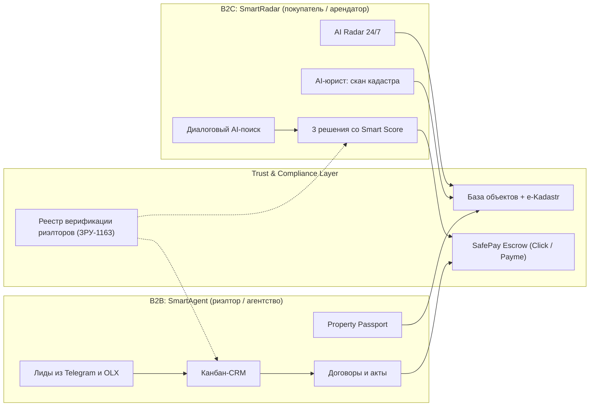

# SmartAgent SuperApp

Единая экосистема недвижимости Узбекистана: рабочая CRM с AI-ассистентом для риэлторов (B2B) и диалоговый AI-риэлтор для покупателей и арендаторов (B2C).

> **Статус:** дизайн-спецификация (версия 2.0, обновлено 2026-10-24). В репозитории пока только документация, исходного кода нет.
> **Рынок:** Узбекистан, старт — Ташкент, дальше СНГ и ОАЭ. **Языки:** русский и узбекский (латиница).

---

## О продукте

Риэлтору SmartAgent помогает принимать обращения из Telegram и OLX, держать под рукой контекст клиента, подбирать актуальные объекты, организовывать показы, вести сделки и честно фиксировать комиссию. Покупателю он вместо 500 объявлений даёт три проверенных решения, сверяет кадастр за 2 минуты и защищает задаток через эскроу.

AI предлагает действия и берёт на себя рутину в рамках выданных разрешений. Важные данные подтверждает человек (Human-in-the-Loop).

**Основная логика продукта:**

```
Обращение → Клиент и потребность → Актуальные объекты → Подборка → Показ →
Следующее действие → Сделка → Комиссия → Повторная рекомендация
```

### Чем продукт не является

- универсальной CRM для любого бизнеса;
- ещё одной доской объявлений;
- чат-ботом, не связанным с карточками клиентов и объектов;
- юридическим сервисом, гарантирующим 100% чистоту объекта без нотариуса;
- автоматическим переговорщиком, который сам принимает коммерческие решения;
- системой, читающей личные сообщения пользователя без его согласия.

## Архитектура экосистемы

Два контура, соединённые общим слоем доверия.



| Контур | Название | Для кого | Суть |
|---|---|---|---|
| B2B | SmartAgent / PropAgent | Риэлторы, агентства | CRM, воронка, лиды, паспорт объекта, договоры |
| B2C | SmartRadar / Uyim | Покупатели, арендаторы, инвесторы | Диалоговый поиск, радар скидок, проверка кадастра, безопасный задаток |
| Мост | Trust & Synergy Layer | Обе стороны | Верификация по ЗРУ-1163, дедуплицированная база, e-Kadastr, эскроу |

## Для кого

**B2B:** независимый риэлтор, владелец агентства (3–15 агентов), руководитель группы, агент по аренде, агент по продаже и новостройкам, ассистент, внешний агент-партнёр.
**B2C:** покупатель жилья, арендатор, семья, инвестор из диаспоры.

## Функционал по приоритетам

Приоритет определяет глубину проработки в прототипе, а не окончательное обязательство разработки.

### P0 — ядро MVP

| Модуль | Что делает |
|---|---|
| Аутентификация и профиль | Вход по номеру +998 (SMS), выбор роли, верификация агента по ЗРУ-1163 |
| Диалоговый поиск (B2C) | Фраза вроде «У меня зарплата 15 млн» → бюджет, платёж и ровно 3 решения со Smart Score (0–100) |
| Воронка CRM | Канбан сделок: Лид → Показ → Аванс → Закрыто, таймеры, ожидаемая комиссия |
| Захват лидов | Единый инбокс: Telegram, OLX, звонки, самозапись |
| Property Passport | Цифровой паспорт объекта, QR-код, микролендинг для клиента |
| Юридический скан | Due Diligence кадастра за 2 минуты, «светофор» рисков |
| Оценка рынка | Экспресс-оценка справедливой цены (CMA): мин / справедливая / макс |
| AI-копирайтер | Описания объявлений на русском и узбекском |

Также в P0: импорт клиентов и объектов из CSV/XLSX, экран «Сегодня», matching и подборки, показы и календарь, задачи и follow-up, базовая аналитика, главный AI-ассистент с подтверждением человеком.

### P1 — основной функционал и выручка

Мультипостинг в один клик, AI-фоторедактор, авто-дожим лидов, умный календарь показов с защитой от неявок, юридические шаблоны, AI Radar, калькулятор полной стоимости входа и ипотека, SafePay Escrow, финансы агента (налог самозанятого 4%).

### P2 — масштабирование

MLS-сеть с делением комиссии 50/50, AI-помощник торга, «Семейная комната», AI-приёмка новостроек и мониторинг долгов ЖКХ, панель агентства, карта инфраструктуры, управление арендой, виртуальный стейджинг.

### P3 — перспектива

Видеопоказ на WebRTC, Remote Buy для диаспоры, коммерческая недвижимость для МСБ, голосовой Voice AI (RU/UZ), Академия риэлтора для подготовки к экзамену по ЗРУ-1163.

> Всё, что требует проверки интеграции, данных или юриста, помечено как *Conditional*: состояния предусмотрены, но успешный результат в прототипе не демонстрируется.

## Регуляторный контекст

Закон Республики Узбекистан № ЗРУ-1163 «О риэлторской деятельности» (с 2026 года):

- обязательная сертификация риэлторов;
- страхование профессиональной ответственности;
- борьба с «чёрными маклерами» — бейдж «Верифицирован ЗРУ-1163» становится ключевым фактором доверия;
- обязательный аудит кадастровых записей: аресты, залоги, судебные споры.

Также учитываются e-Kadastr и закон о защите прав потребителей.

## Навигация

| Режим | Вкладки |
|---|---|
| **B2B (риэлтор)** | Сегодня · Лиды · Объекты · Клиенты · Ещё |
| **B2C (покупатель)** | Диалог · Radar · Избранное / Семья · Сделка · Профиль |
| **Desktop (агентство)** | Левая sidebar и рабочая область для таблиц, импорта и аналитики команды |

Для iOS 26 экранный набор (5 вкладок, раздел «Ещё» с 12 разделами, iPad `NavigationSplitView`, быстрая голосовая запись) описан в [`docs/product-app.md`](docs/product-app.md).

## Продуктовые принципы

1. Пользователь контролирует отношения, а также юридические и финансовые решения.
2. AI не меняет финансовые данные, права, этап сделки и не отправляет сообщения клиентам без подтверждения. Черновики помечены как «Черновик AI — проверьте перед отправкой».
3. Данные не объединяются молча: при риске потери истории нужно подтверждение.
4. Доверие важнее обещаний: статус «проверен» или «доступен» всегда показывает дату последней проверки.
5. Никаких неподтверждённых обещаний вроде «+40% продаж» и «ни одного потерянного лида».
6. Ожидаемая и полученная комиссия — разные состояния с разными подписями.
7. Любая ошибка в AI-черновике исправляется в один клик.

## Дизайн-система «Mono-Ink AI»

Clean Modern: эргономика Apple-native, рабочая ясность Linear, аккуратность данных Stripe.

- **Монохром + смысловые акценты.** Цвет только для статуса (успех `#1E9E5E`, предупреждение `#E9A23B`, ошибка `#E7000B`) и брендов каналов.
- **Capsule-first.** Кнопки, поля, чипы, сегменты и бейджи — полностью скруглённые; карточки — 16 pt continuous, граница 1 pt без теней.
- **Табличные цифры** (`monospacedDigit`) для цен, дат, таймеров и процентов.
- **Стекло для хрома.** Шапка, таб-бар и панели действий — Liquid Glass (в iOS 26) или blur.
- **Один главный CTA на экран.**
- **Каждое действие оставляет след:** тост с «Отменить» и запись в журнал.
- **Шрифты:** SF Pro / Onest / Inter, SF Mono / JetBrains Mono для цифр. Иконки: Lucide ↔ SF Symbols.
- **Темы:** светлая и тёмная, токены в OKLCH с HEX-эквивалентами.

Полные токены, типографика, анимации и компоненты — в разделах 9 и 11 [`docs/product-design.md`](docs/product-design.md).

## Обязательные сквозные сценарии прототипа

| Flow | Сценарий |
|---|---|
| A | Новый лид → квалификация → follow-up |
| B | Запрос клиента → matching → подборка |
| C | Новый объект → система находит подходящих клиентов |
| D | Показ → результат → следующий контакт |
| E | Сделка → комиссия → фактическое поступление |
| F | Руководитель находит утечку в процессе |
| G | Импорт базы без потери данных |
| H | AI предлагает действие, человек подтверждает |
| I | B2C: от фразы о зарплате до 3 решений |
| J | 2-минутный скан кадастра со светофором рисков |

Для каждого экрана нужны состояния: Loading/Skeleton, Empty, Error, Offline, Stale Data, Unverified.

## Доступность

WCAG 2.1 AA: контраст ≥ 4.5:1, зона касания ≥ 44×44 pt, VoiceOver-метки, Dynamic Type до AX-размеров, Reduce Motion, Reduce Transparency. Статус никогда не передаётся только цветом.

## Локализация

Русский (основной) и узбекский (латиница). Две валюты — доллары и сумы, без молчаливой конвертации. Тексты короткие и спокойные, без фальшивой срочности.

## Документация

| Файл | Содержание |
|---|---|
| [`docs/product-design.md`](docs/product-design.md) | Мастер-спецификация SmartAgent SuperApp: аудитории и боли, матрица функционала P0–P3, информационная архитектура, каталог функций, карта экранов, сквозные сценарии, состояния, дизайн-система, локализация, требования к Figma, Definition of Done, открытые вопросы |
| [`docs/product-app.md`](docs/product-app.md) | Спецификация нативного iOS 26 приложения (SwiftUI) на основе веб-прототипа SmartAgent: токены, компоненты, навигация, функционал по разделам, адаптация под iOS 26, доступность, чек-лист соответствия |

В `product-design.md` (раздел 17) упомянуты документы, которых в репозитории пока нет: `product.md` (PRD CRM), `sa-about.md` (позиционирование) и техническая спецификация API.

## Что нужно решить до разработки

Эти вопросы в документации намеренно оставлены открытыми, их нельзя придумывать в макетах:

- способ авторизации и данные для первого входа;
- какие каналы и интеграции реально поддерживаются в первой версии;
- какие источники объектов можно законно импортировать и показывать;
- что значит «проверен» для объекта и кто проверяет;
- SLA и правила распределения лидов;
- какие AI-возможности реально реализованы, с каким качеством и стоимостью;
- какие сообщения AI отправляет сам, а какие только готовит;
- тарифы, лимиты и условия возврата;
- какие юридические шаблоны одобрены локальным юристом;
- права внешнего партнёра и момент раскрытия контакта клиента;
- какие метрики доступны в аналитике на старте и как они считаются.

## Структура репозитория

```
smartagent/
├── README.md
└── docs/
    ├── product-design.md   # мастер-спецификация продукта и UX
    └── product-app.md      # спецификация iOS 26 приложения
```
