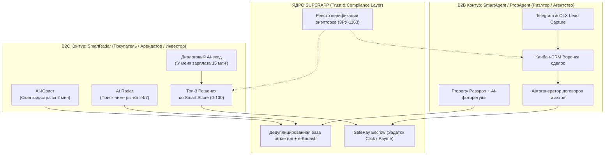

# SmartAgent SuperApp — `product-design.md`
## Мастер-спецификация продуктового дизайна, архитектуры и функционала

---

## 0. Назначение документа и Архитектурный фреймворк SuperApp

Документ предназначен для UX/UI-дизайнера, Product Manager и команды разработки. Он объединяет информационную архитектуру, пользовательские сценарии, каталог болей и решений, а также требования к **полноценному кликабельному прототипу SuperApp**. Это не просто визуальная концепция и не набор несвязанных экранов. Дизайнер должен понять, кто пользуется продуктом, какие рабочие и жизненные проблемы он решает, какие данные нужны на каждом шаге, что происходит после каждого действия и как пользователь восстанавливается после ошибок.

Для **каждой функции** в документе зафиксированы:
- какую пользовательскую боль она решает;
- какую ценность должна создавать;
- какие элементы и экраны нужно спроектировать;
- какие действия доступны пользователю;
- приоритет реализации (P0, P1, P2, P3);
- какие состояния и ограничения нельзя забыть.

### 0.1. Двухконтурная модель SuperApp (Архитектура экосистемы)

SuperApp объединяет две ключевые стороны рынка недвижимости в единый доверенный конвейер:
1. **B2B Контур (`SmartAgent / PropAgent`):** Мобильная операционная система риэлтора-одиночки и агентства (CRM, канбан-воронка, омниканальный захват лидов из Telegram/OLX, Property Passport, проверка кадастра, автогенерация контента, шаблоны договоров).
2. **B2C Контур (`SmartRadar / Uyim`):** Диалоговый ассистент покупателя и арендатора («Решай задачи, а не листай 500 объявлений», расчет бюджета за одну фразу, радар скидок, проверка юридической чистоты, безопасный задаток SafePay).
3. **Мост доверия и регуляторного соответствия (`Trust & Synergy Layer`):** Верификация риэлторов по Закону РУз № ЗРУ-1163, дедуплицированная база объектов, открытый кадастровый аудит (e-Kadastr) и защищенные эскроу-платежи через Click/Payme.

### 0.2. Регуляторный контекст: Закон РУз № ЗРУ-1163 «О риэлторской деятельности»
С 2026 года в Узбекистане вступает в силу обновленное законодательство:
- **Обязательная сертификация риэлторов:** Каждый практикующий агент обязан иметь квалификационный аттестат государственного образца.
- **Страхование ответственности:** Сделки с недвижимостью должны быть защищены страховым полисом профессиональной ответственности.
- **Борьба с черными маклерами:** Клиенты требуют подтверждения статуса специалиста; бейдж «Верифицирован ЗРУ-1163» в профиле становится главным фактором конверсии.
- **Прозрачность прав собственности:** Обязательный аудит кадастровых записей, отсутствия арестов, судебных споров и залогов.

### 0.3. Какие материалы имеют приоритет при проектировании

1. Безопасность, контроль доступа, законность использования данных и достоверность обещаний.
2. Ядро CRM и подтверждённый MVP (P0): лиды → клиенты/запросы → объекты → подбор → показы → задачи → сделки → комиссия/аналитика.
3. B2C диалоговый сценарий быстрого решения (SmartRadar): поиск за одну фразу → 3 лучших решения → скан кадастра → запись на показ.
4. Telegram-first и AI-помощь, если она действительно сокращает ручную работу и не скрывает, что требует подтверждения человеком (Human-in-the-Loop).
5. Функции будущих этапов: расширенные каналы, рынок объявлений, автоматическая оценка, ипотека, документы, аренда, геймификация и маркетплейс.

Продуктовые гипотезы должны визуально обозначаться как гипотезы. Дизайнер не придумывает неподтверждённые интеграции, источники данных, юридические гарантии, рыночные цены, точность AI или уже существующую автоматизацию.

---

# 1. Продукт в одном абзаце

**SmartAgent SuperApp — единая экосистема недвижимости Узбекистана, объединяющая AI-ассистента и рабочую CRM для риэлторов (B2B) с диалоговым AI-риэлтором для покупателей и арендаторов (B2C).** Риэлтору он помогает принимать и не терять обращения из Telegram и OLX, держать под рукой контекст клиента, находить актуальные объекты, организовывать показы, контролировать сделки и честно фиксировать комиссию. Покупателю он заменяет 500 мусорных объявлений тремя идеальными решениями на основе реального бюджета, проверяет кадастр за 2 минуты и защищает аванс через безопасный эскроу SafePay. AI предлагает действия и выполняет рутину в рамках разрешений; человек подтверждает важные данные и сохраняет контроль над отношениями, переговорами и юридическими решениями.

### 1.1. Продукт не является
- универсальной CRM для любого абстрактного бизнеса;
- ещё одной публичной доской объявлений, которая пытается конкурировать с классифайдами во всех сценариях;
- чат-ботом, который только пишет ответы и не связан с карточками клиентов/объектов;
- юридическим сервисом, гарантирующим 100% абсолютную чистоту недвижимости без участия нотариуса;
- автоматическим переговорщиком, который самостоятельно принимает коммерческие решения от имени риэлтора;
- системой, которая может по умолчанию читать личные сообщения пользователя во всех мессенджерах.

### 1.2. Основное обещание UX
> **«Всё важное по клиентам, объектам и сделкам — в одном месте. SmartAgent показывает, что требует внимания, помогает быстро сделать следующий шаг и сокращает рутину»**.

Не использовать неподтверждённые рекламные обещания вроде «увеличит продажи на 40%», «ни одного потерянного лида» или «все объекты проверены». Такие результаты могут стать целями экспериментов, но не утверждениями в интерфейсе.

---

# 2. Аудитории и их рабочие задачи

## 2.1. Основные персоны

### B2B Персоны (Профессиональный контур)
| Персона | Контекст и цели | Главные боли | Что должно доказывать ценность | Приоритет |
|---|---|---|---|---|
| **Независимый риэлтор (частный маклер)** | Работает в телефоне, использует Telegram, звонки, заметки и таблицы; самостоятельно ведёт клиентов и объекты (~80% рынка) | Теряет контекст переписок, повторно задаёт вопросы, вручную подбирает объекты, забывает follow-up, боится проверок ЗРУ-1163 | Полезный экран за первые минуты; быстрый ввод; карточка клиента; подбор; задачи и напоминания; статус легального риэлтора | P0 |
| **Владелец агентства (3–15 агентов)** | Распределяет лиды, управляет базой, следит за сотрудниками и доходом | Клиенты и контакты остаются у агентов; нет единой базы; при увольнении агент уносит клиентов; комиссия непрозрачна | Общая база; назначения; права; воронка; отчётность по результату; аудит; защита базы от увода | P0 |
| **Руководитель группы / отдела продаж (РОП)** | Контролирует очередь лидов, SLA, загрузку и конверсию | Отчёты собираются вручную; видны звонки, но не качество продвижения к сделке | Очередь рисков, просрочки, причины потерь, результативность этапов | P0/P1 |
| **Агент по аренде** | Высокий темп, много однотипных объектов, срочные показы и быстрые изменения доступности | Объекты быстро устаревают; показы конфликтуют; запросы клиентов похожи | Быстрый matching, статус доступности, календарь и клиентская подборка в 1 клик | P0 |
| **Агент по продаже / новостройке** | Длинный цикл, торг, несколько участников, документы | Теряет договорённости и этапы, не знает, кто и что должен сделать | История касаний, задачи, этапы сделки, документы и расчёт комиссии | P0/P1 |
| **Ассистент / оператор** | Помогает обрабатывать входящие обращения и организовывать календарь | Неясны приоритеты и границы доступа, сложно эскалировать важные вопросы | Упрощённые формы, очередь, шаблоны, роли и понятная передача человеку | P1 |
| **Внешний агент-партнёр** | Участвует только в конкретной совместной сделке | Споры об источнике клиента/объекта, условиях и долях; риск утечки контактов | Ограниченный доступ к согласованной записи и зафиксированные условия MLS (50/50) | P1/P2 |

### B2C Персоны (Клиентский контур)
| Персона | Контекст и цели | Главные боли | Что должно доказывать ценность | Приоритет |
|---|---|---|---|---|
| **Покупатель жилья (Первичный покупатель)** | Ищет квартиру для семьи, располагает зарплатой или накоплениями, боится переплатить и быть обманутым | 500 фейковых объявлений на досках; непонятно, сколько реально нужно денег со всеми пошлинами; страх мошенников | Диалог «Зарплата 15 млн» → расчет бюджета и 3 лучших проверенных варианта со Smart Score; 2-мин скан кадастра | P0 |
| **Арендатор** | Срочно ищет квартиру в аренду около работы или метро | Завышенные залоги, комиссии не за что, риск внезапного выселения | Поиск без комиссии или с проверенным агентом, онлайн-договор, прозрачный учет депозита | P0/P1 |
| **Семья (Муж, Жена, Родители)** | Принимают решение коллегиально, спорят о приоритетах | Ссылки теряются в чатах, разные критерии (школа vs метро vs ремонт) | Семейная комната (Family Room) со совместным голосованием и рейтингом согласия | P2 |
| **Инвестор / Диаспора за рубежом** | Граждане РУз в РФ, Корее, ОАЭ, США, инвестирующие в новостройки Ташкента | Невозможность приехать на показ, валютный контроль, страх недостроя | Дистанционный видеотур WebRTC, аудит застройщика, покупка под ключ Remote Buy | P3 |

## 2.2. Что объединяет эти персоны
Продукт должен экономить время без чрезмерной бюрократии. На ключевых экранах важнее показать **следующее действие, контекст и статус**, чем выводить десятки полей одновременно.

## 2.3. Карта ключевых болей рынка

| ID | Боль | Последствие для бизнеса | Продуктовый ответ | Как пользователь должен увидеть решение |
|---|---|---|---|---|
| P-01 | Лиды распределены между мессенджерами, звонками, сайтом, рекомендациями и таблицами | Поздний ответ, забытые обращения, потеря атрибуции источника | Единый инбокс, источник, SLA, ответственный, статус | Вся очередь новых лидов на одном экране; видно, кто и что делает дальше |
| P-02 | История клиента хранится в памяти и чатах | Повторные вопросы, неподходящие предложения, потеря доверия | Карточка клиента, потребность и timeline | Риэлтор быстро видит бюджет, критерии, историю и прошлые отказы |
| P-03 | Объекты не структурированы, дублируются или устарели | Потеря времени, поездки впустую, неправильный подбор | Структурированный каталог, источник, дата проверки, статусы и дубли | Список с заметной актуальностью и объяснимым статусом объекта |
| P-04 | Подбор недвижимости выполняется вручную | Медленная реакция и мало времени на отношения/переговоры | Поиск и matching по запросу, объяснение совпадений | Быстрые результаты с точными и частичными совпадениями |
| P-05 | После контакта нет следующего действия | Лиды «остывают» и забываются | Задачи, follow-up, план дня и напоминания | Чёткая очередь действий, просрочки и быстрые кнопки |
| P-06 | Показы организуются вручную | Переносы, пересечения, неполная обратная связь | Календарь, запись, статус, результат и next step | Видно расписание дня и можно за несколько действий записать результат |
| P-07 | Воронка и отчёты не отражают реальный результат | Руководитель не понимает, где теряется конверсия | Pipeline, причины проигрыша, метрики по этапам | Видно, где застревают лиды и что требует внимания |
| P-08 | Комиссия и совместная сделка фиксируются в переписке | Споры, ошибочные расчёты и недоверие | Расчёт долей, согласование и аудит изменений | Прозрачные ожидаемые/полученные суммы и утверждённые условия |
| P-09 | Повторный ввод данных отнимает время | Меньше реальной работы с клиентами | Импорт, шаблоны, голос/текст, AI-извлечение и автологирование | Пользователь подтверждает черновик вместо заполнения формы с нуля |
| P-10 | AI отдельно от рабочего процесса | Ещё один чат, не дающий системной экономии | Ассистент, связанный с клиентами, объектами и задачами | Ответ AI заканчивается конкретным действием в CRM |
| P-11 | Собственник/руководитель не контролирует активы агентства | История и контакты уезжают вместе с сотрудником | Общая база, роли, переназначение и аудит | При смене агента данные и история сохраняются в рамках прав доступа |
| P-12 | Слабая аналитика объекта/рынка | Сложно аргументировать цену и оценивать качество предложения | История цены, источники, оценка CMA и светофор рисков | Источник и дата данных видны; юридический статус понятен за 2 минуты |

---

# 3. Приоритеты и границы реализации

Приоритет показывает глубину дизайна/прототипа, а не окончательное обязательство разработки:
- **P0 — ядро MVP:** спроектировать детально и связать в кликабельные сквозные сценарии.
- **P1 — Core & Revenue loop:** показать в информационной архитектуре и спроектировать ключевые экраны/состояния; первый платный функционал.
- **P2 — Scale & Collaboration:** сетевые эффекты (MLS), дифференциаторы рынка, углубленные AI-инструменты, кабинет агентства.
- **P3 — Future & Ecosystem:** перспективные концепции (Voice AI, Remote Buy, коммерция для МСБ).
- **Conditional — только после проверки интеграции/данных/юриста:** предусмотреть состояния, но не демонстрировать успешный результат, если backend или рабочий процесс не подтверждены.

---

## 📋 СВОДНАЯ МАТРИЦА ФУНКЦИОНАЛА SUPERAPP ДЛЯ ДИЗАЙНЕРА

### 🔴 ПРИОРИТЕТ P0: MVP / КРИТИЧЕСКИЙ ФУНКЦИОНАЛ (CORE LAUNCH)

| # | Модуль / Экран | Функционал (Feature) | Проблема пользователя (User Pain) | Решение продукта (Product / UX Solution) | Требования для UI/UX дизайнера (Screens, UI Components, UX Patterns) |
|---|---|---|---|---|---|
| **01** | **Аутентификация & Профиль** (`Auth & Identity`) | **Двусторонний умный онбординг с верификацией по ЗРУ-1163** | Риэлторы боятся проверок и штрафов по новому закону 1163; клиенты не доверяют незнакомым маклерам с улицы («таниш-билиш»). | Вход по номеру телефона (+998 SMS). Выбор роли (Агент / Покупатель / Собственник). Для агента: ввод ПИНФЛ/сертификата риэлтора с получением бейджа «Верифицирован ЗРУ-1163». Для клиента: экспресс-настройка цели в 3 шага. | **Экраны:** Splash, Выбор роли, SMS-ввод (4 цифры), Онбординг агента (загрузка сертификата), Онбординг клиента. **UI-компоненты:** Пин-код инпут, селектор роли с иконками, бейдж доверия (зеленый щит `#34A853`), прогресс-бар 1-2-3. **Состояния:** Default, Verified, Under Review, Error. |
| **02** | **B2C: Диалог-поиск** (`Dialog-First Search`) | **Диалоговый AI-поиск по естественной фразе («У меня зарплата 15 млн»)** | Обычные фильтры с 20 полями перегружают; покупатель не знает, на какую квартиру реально хватает бюджета, и теряется в 500 мусорных объявлениях. | Диалоговое окно вместо каталога. Пользователь пишет или говорит одну фразу. AI вычисляет максимальный бюджет, ежемесячный платеж и выдает **ровно 3 лучших решения** со Smart Score (0–100) и честным вердиктом («рекомендую / не рекомендую»). | **Экраны:** Главный экран SmartRadar (интент-карточки), Экран чата с AI, Экран выдачи «3 лучших решения». **UI-компоненты:** Чат-пузыри с карточками квартир внутри, чипсы быстрых ответов («Бюджет $50k», «Около метро»), голосовая кнопка с анимацией волны, бейдж Smart Score с цветовой градацией. **UX-паттерн:** Мгновенный фидбек без перезагрузки экрана. |
| **03** | **B2B: Воронка CRM** (`Deals Kanban Pipeline`) | **Мобильная канбан-доска сделок (Лид → Показ → Аванс → Закрыто)** | Маклер ведет дела в блокноте, памяти и 5 чатах. Забывает перезвонить, теряет клиентов и комиссию ($500–$2000 за сорванную сделку). | Вертикальный/горизонтальный адаптивный канбан. Карточка сделки содержит контакт, таймер до следующего действия, статус документов, сумму комиссии и чек-лист шагов. Работает оффлайн с синхронизацией. | **Экраны:** Главный дашборд агента, Канбан-воронка, Карточка сделки с табами (Инфо, Чат, Документы, Заметки). **UI-компоненты:** Drag-and-drop карточки сделки, бейджи срочности (красный «Просрочено 2 часа», зеленый «Сегодня показ»), счетчик ожидаемой комиссии в шапке, плавающая кнопка `+ Сделка`. |
| **04** | **B2B: Захват лидов** (`Lead Capture & Inbox`) | **Telegram & OLX Lead Capture + Единый омниканальный инбокс** | Запросы клиентов разбросаны: группы Telegram («Недвижимость Ташкент»), личка, OLX, звонки. Агент не успевает отвечать, конкуренты перехватывают клиентов. | Телеграм-бот мониторит ключевые группы и сообщения. Распознает запросы («куплю 2к на Чиланзаре до $45k») и автоматически создает карточку лида в CRM. Входящие из всех каналов собираются в один чат-инбокс приложения. | **Экраны:** Единый инбокс (табы: Все / Telegram / OLX / Звонки), Карточка нового лида (Quick Match), Настройка интеграции каналов. **UI-компоненты:** Иконка источника лида (логотип TG / OLX на аватаре), кнопка «Принять в работу» / «В архив», свайп-действия в списке сообщений. |
| **05** | **B2B/B2C: Паспорт объекта** (`Property Passport`) | **Цифровой паспорт объекта с QR-кодом и микролендингом** | Агент отправляет клиенту неструктурированную «простыню» текста и 15 несжатых фото в Telegram. Выглядит непрофессионально, ключевые параметры теряются. | Структурированная карточка объекта: фотогалерея, параметры, планировка, кадастровый статус, геолокация. Генерируется веб-ссылка и QR-код для пересылки клиенту в WhatsApp/Telegram без установки приложения. | **Экраны:** Редактор паспорта объекта, Экран карточки объекта в приложении, Веб-микролендинг для клиента (Mobile Web View). **UI-компоненты:** Карусель фото с зумом, сетка характеристик (иконка + текст), кнопка «Поделиться в Telegram» (генерация красивого превью), кнопка «Записаться на просмотр». |
| **06** | **Юридический скан** (`Legal & Cadastre Due Diligence`) | **2-минутный Due Diligence проверка кадастра и рисков (Закон 1163)** | Огромный страх мошенничества: скрытые наследники, залоги в банке, аресты, незаконные перепланировки, риск потерять деньги при покупке. | Ввод кадастрового номера или фото техпаспорта. Сервис запрашивает открытые госреестры и выдает понятный «Светофор чистоты»: Зеленый (Чисто), Желтый (Внимание: прописаны дети), Красный (Обременение/Арест). | **Экраны:** Ввод кадастра / скан документа, Экран экспресс-проверки (бесплатный мини-отчет), Экран полного Due Diligence отчета. **UI-компоненты:** Индикатор рисков (зеленый/желтый/красный щит), чеклист 7 юридических проверок с галочками, блок «Что это значит простыми словами», кнопка скачивания PDF-отчета. |
| **07** | **Оценка рынка** (`Instant Valuation & CMA`) | **Экспресс-оценка справедливой цены и переплаты за 30 секунд** | Продавцы завышают цены «по совету соседей», объекты зависают на 6 месяцев. Покупатели боятся переплатить $5,000–$10,000. | Пользователь вводит адрес и параметры. Алгоритм на базе парсинга реальных сделок и актуальных объявлений выдает диапазон цены (мин / справедливая / макс), отклонение от рынка в % и прогноз срока продажи. | **Экраны:** Экран ввода адреса и комнатности, Экран результатов оценки (график + вердикт). **UI-компоненты:** Спидометр/шкала цены (Ниже рынка / В рынке / Переоценено), сравнение с 3 аналогами рядом, карточка «Рекомендуемый торг». |
| **08** | **Контент-генератор** (`AI Copywriter & Formatter`) | **AI-генерация продающих описаний на русском и узбекском языках** | Риэлтор тратит 20–30 минут на составление каждого текста, пишет безграмотно или шаблонно («Срочно продам шикарную квартиру»), объявления не цепляют. | Агент отмечает параметры галочками (этаж, ремонт, мебель, локация). AI за 5 секунд генерирует 3 варианта текста: для Telegram-канала (с эмодзи и структурой), для OLX (с ключевыми словами) и на узбекском языке. | **Экраны:** Модальное окно «Сгенерировать описание», Экран выбора варианта текста. **UI-компоненты:** Переключатель стиля (Деловой / Эмоциональный / Краткий для TG), переключатель языка (RU / UZ латиница), кнопка «Скопировать в буфер». |

---

### 🟡 ПРИОРИТЕТ P1: ОСНОВНОЙ ФУНКЦИОНАЛ (CORE & REVENUE LOOP)

| # | Модуль / Экран | Функционал (Feature) | Проблема пользователя (User Pain) | Решение продукта (Product / UX Solution) | Требования для UI/UX дизайнера (Screens, UI Components, UX Patterns) |
|---|---|---|---|---|---|
| **09** | **Мультипостинг** (`1-Click Multi-Posting`) | **Публикация объявления в 1 клик (Telegram-каналы + Маркетплейс + OLX)** | Агент тратит до 40 минут на ручное копирование фотографий и текстов по 5 площадкам. Часто забрасывает и теряет 60% охвата. | После заполнения карточки объекта агент нажимает одну кнопку. Объявление автоматически публикуется в личный TG-канал, партнерские группы, внутренний маркетплейс SuperApp и генерирует готовый предзаполненный драфт для OLX. | **Экраны:** Экран каналов публикации, Статус размещения (Success/In Progress/Error). **UI-компоненты:** Тогглы площадок (Telegram, Маркетплейс, OLX, Instagram), индикатор статуса публикации, лог ссылок на опубликованные посты. |
| **10** | **AI-фоторедактор** (`AI Real Estate Photo Lab`) | **Авто-улучшение интерьерных фото (свет, горизонт стен, удаление мусора)** | 70% объявлений в Ташкенте с темными, кривыми фото с разбросанными вещами. Покупатели пролистывают такие объекты, агент теряет звонки. | Встроенный в камеру и галерею AI-модуль: автоматическое выравнивание вертикалей стен (anti-tilt), осветление темных комнат, удаление случайного мусора (AI Inpainting), автоподбор лучшего кадра на обложку. | **Экраны:** Экран фотосъемки объекта с направляющими уровня, Экран редактирования с ползунком «До / После» (Before/After split view). **UI-компоненты:** Интерактивный разделитель До/После, чипсы быстрых улучшений («Осветлить», «Выровнять стены», «Убрать лишнее»), значок AI HD. |
| **11** | **Авто-дожим лидов** (`AI Lead Follow-up Engine`) | **Автоматические цепочки касаний и реактивации «забытых» лидов** | 80% сделок срываются, потому что агент забыл перезвонить на 3-й день. База «старых лидов» в CRM лежит мертвым грузом. | Система автоматически отправляет персонализированные касания в Telegram/WhatsApp клиенту по триггерам: «Появилась новая квартира под ваш запрос», «Снизилась цена на смотрели на Юнусабаде», «Актуален ли поиск?». | **Экраны:** Настройка правил автокасаний, Карточка цепочки коммуникации, Экран реактивации архива. **UI-компоненты:** Таймлайн цепочки сообщений (День 1 → День 3 → День 7), превью сообщений с переменными `{Имя}`, `{Район}`, переключатель «Автоотправка / С одобрения агента». |
| **12** | **Календарь показов** (`Smart Showing Schedule`) | **Умное расписание показов с SMS/TG-напоминаниями и трекингом неявок** | «Нет-шоу» — клиенты не приходят на показ, агент едет через весь город по пробкам Ташкента и теряет 2 часа впустую. | Календарь со слотами показов. Клиент подтверждает время в один клик в Telegram. Автонапоминание за 2 часа и за 30 минут с кнопкой подтверждения. Если клиент отменяет — слот мгновенно освобождается. | **Экраны:** Недельный календарь показов, Экран записи на слот, Экран подтверждения для клиента (TMA/Web). **UI-компоненты:** Календарная сетка с цветовой дифференциацией объектов, плашка статуса визита («Подтвердил», «Едет», «Не явился»), карточка маршрута с картой пробок. |
| **13** | **Юридические шаблоны** (`Smart Contracts & Docs`) | **Генератор договоров и актов по законодательству РУз с автозаполнением** | Риэлторы используют устаревшие «рыбы» из Word, где путают реквизиты, не учитывают Закон 1163 и рискуют получить судебный иск. | Библиотека стандартизированных шаблонов: предварительный договор купли-продажи, договор аренды, расписка в авансе, акт приема-передачи. Данные паспорта и кадастра вставляются автоматически. Экспорт в защищенный PDF. | **Экраны:** Каталог шаблонов документов, Мастер заполнения по шагам, Предпросмотр PDF с возможностью цифровой подписи. **UI-компоненты:** Шаговый визард, поля с автокомплитом из карточки клиента/объекта, кнопка «Поделиться PDF в Telegram», печать документа. |
| **14** | **AI-Radar поиска** (`Passive AI Radar Monitor`) | **Круглосуточный фоновый мониторинг рынка с алертами на объекты ниже цены** | Выгодные квартиры по цене ниже рынка разбирают за 2–3 часа. Покупатель физически не может обновлять каналы 24/7. | Пользователь задает параметры (район, комнатность, бюджет). AI Radar сканирует рынок круглосуточно. При появлении срочной продажи или скидки присылает Push с меткой «Ниже рынка на 12%» и расчетом чистой выгоды. | **Экраны:** Экран настройки Radar (слайдеры бюджета и локации), Лента находок радара, Экран Push-уведомления на локскрине. **UI-компоненты:** Анимированный сканер радара (пульсирующий круг), карточка находки со значком «HOT DEAL -15%», счетчик просканированных объявлений (создает ощущение работы AI). |
| **15** | **Финансы & Ипотека** (`Total Cost & Mortgage Hub`) | **Калькулятор «Полная стоимость входа» + Подбор банков по одобрению** | Клиент думает, что квартира стоит $50k, а на сделке оказывается, что нужно еще $4k на налоги, нотариуса, госпошлины и риэлтора. Сделка срывается из-за кассового разрыва. | Полная прозрачная смета сделки: цена объекта + госпошлина + нотариус + налог + комиссия + страховка. Вкладка ипотеки: расчет ежемесячного платежа по банкам РУз (Ипотека банк, SQB, Hamkorbank) с кнопкой отправки заявки на предодобрение. | **Экраны:** Калькулятор расходов на сделку, Сравнение условий банков по ипотеке, Форма заявки на ипотеку. **UI-компоненты:** Круговая диаграмма структуры расходов, карточки банков с процентом вероятности одобрения (Scorecard), интерактивный слайдер первоначального взноса. |
| **16** | **Безопасная сделка** (`SafePay Escrow Service`) | **Эскроу-бронирование задатка через Click / Payme с арбитражем** | Страх передачи наличных в задаток: продавец взял аванс и исчез или передумал продавать; покупатель не может вернуть деньги. | Покупатель вносит задаток на защищенный эскроу-счет платформы через Click/Payme. Продавец видит заморозку средств. Деньги переводятся продавцу только после регистрации договора у нотариуса или возвращаются при срыве сделки. | **Экраны:** Экран условий задатка, Экран оплаты эскроу, Статус заморозки средств, Экран закрытия сделки / Арбитраж. **UI-компоненты:** Таймер заморозки средств, статус-бар сделки (Внесено → Проверка нотариуса → Выплачено), логотипы платежных систем Click / Payme / Uzum. |
| **17** | **Финансы агента** (`Agent Commission & Wallet`) | **Дашборд учета заработанных комиссий, налогов и расходов** | Риэлтор не понимает свою реальную прибыль, путает личные деньги и бизнес-расходы, не готов к отчетности по самозанятости. | Персональный финансовый трекер: заработано за месяц, ожидается к выплате, средний чек сделки, налог самозанятого (4%), конверсия показов в деньги. | **Экраны:** Главный финансовый дашборд агента, Детализация комиссий по объектам, Экран формирования налоговой справки. **UI-компоненты:** Карточки ключевых метрик (MRR, закрытые сделки), линейный график дохода по месяцам, прогресс выполнения личного финансового плана. |

---

### 🟢 ПРИОРИТЕТ P2: МАСШТАБИРОВАНИЕ И ДИФФЕРЕНЦИАЦИЯ (SCALE & COLLABORATION)

| # | Модуль / Экран | Функционал (Feature) | Проблема пользователя (User Pain) | Решение продукта (Product / UX Solution) | Требования для UI/UX дизайнера (Screens, UI Components, UX Patterns) |
|---|---|---|---|---|---|
| **18** | **Сеть партнерств** (`Co-Brokering & MLS Network`) | **Внутренняя MLS-база партнерских сделок со сплитом комиссии (50/50)** | У агента есть покупатель с деньгами, но нет подходящей квартиры. Покупатель уходит. У соседа есть квартира, но нет покупателя. Нет доверия делить комиссию. | Единый закрытый реестр объектов с галочкой «Готов к совместной сделке 50/50». Защищенный протокол фиксации клиента за агентом (исключает перехват клиента). Автоматический сплит комиссии при закрытии. | **Экраны:** Вкладка MLS в поиске объектов, Экран предложения о партнерстве, Карточка соглашения о разделении комиссии. **UI-компоненты:** Бейдж «MLS 50/50 Партнерство», кнопка «Предложить клиенту», рейтинг надежности партнера (звезды + число закрытых партнерств). |
| **19** | **AI-Торг на объекте** (`AI Negotiation Co-Pilot`) | **AI-ассистент торга на базе дефектов и сравнительного анализа** | Агент или покупатель не умеет аргументированно сбивать завышенную цену на объекте. Торг выглядит как базарный спор. | Ассистент анализирует переоценку района + найденные дефекты квартиры (требуется замена проводки, первый этаж, старые трубы) и генерирует структурированный скрипт торга с калькуляцией: «Цена завышена на $4,200 на основании 3 факторов...». | **Экраны:** Экран чеклиста дефектов при осмотре, Экран калькулятора скидки, Скрипт переговоров для экрана смартфона. **UI-компоненты:** Чекбоксы дефектов с авторасчетом стоимости их устранения, кнопка «Сгенерировать предложение о покупке (Offer letter)». |
| **20** | **Семейное решение** (`Family Decision Room`) | **«Семейная комната» для совместного выбора квартиры и голосования** | Покупка жилья — стрессовый семейный процесс (муж, жена, родители). Ссылки теряются в чатах, возникают конфликты мнений. | Общее виртуальное пространство для семьи: добавление вариантов в шорт-лист, голосование (Лайк / Дизлайк), комментарии к каждому объекту, сводная таблица согласия семьи со Smart Score. | **Экраны:** Экран Семейной комнаты, Карточка голосования за объект (Tinder-свайп или кнопки), Сводная матрица мнений. **UI-компоненты:** Аватары членов семьи с их оценками (👍/👎), диаграмма совпадения интересов («Совпадение 87%»), общий чат внутри объекта. |
| **21** | **Приемка & ЖКХ** (`Smart Inspection & Utility Monitor`) | **AI-приемка новостройки (дефектный акт) + мониторинг долгов ЖКХ** | Дольщики принимают квартиры с кривыми стенами и протечками, застройщик игнорирует исправления. Покупатели вторички получают чужие долги за свет и газ. | Фотографирование дефектов через камеру — AI распознает трещины, сколы, неровности и формирует официальный Дефектный акт для застройщика по СНиП РУз. Для вторички: ввод лицевых счетов коммуналки и мгновенный аудит долгов. | **Экраны:** Сканер дефектов через камеру с рамкой обнаружения, Сформированный дефектный акт (PDF), Дашборд проверки долгов ЖКХ. **UI-компоненты:** AR-маркеры на фото дефектов, статус-бар погашения коммунальных долгов, кнопка отправки претензии застройщику. |
| **22** | **Панель агентства** (`Agency Enterprise Dashboard`) | **Кабинет руководителя агентства (контроль агентов, защита базы от увода)** | Руководитель не видит реальную конверсию маклеров; при увольнении агент уносит телефонную книгу и клиентскую базу с собой. | Корпоративный веб/планшет-дашборд: сквозная воронка по всем сотрудникам, распределение лидов по загрузке, скрытие полных номеров клиентов (маскирование звонков), сохранение всей истории в компании. | **Экраны:** Дашборд директора (KPI команды), Экран распределения лидов, Карточка сотрудника с аналитикой конверсии. **UI-компоненты:** Таблица сотрудников с сортировкой по выручке, воронка конверсии агентов, переключатель прав доступа (Owner/Manager/Agent). |
| **23** | **Инфраструктура** (`Neighbourhood & Map Intel`) | **Анализ локации и карта инфраструктуры (школы, метро, парки, экология)** | Покупатели смотрят на стены квартиры, но не знают, что до ближайшей школы 2 км по пробкам, а по вечерам загазованность. | Интерактивная карта с изохронами пешей доступности (5-10-15 мин), слои инфраструктуры (метро, поликлиники, государственные и частные школы, мечети), оценка экологии и шума района. | **Экраны:** Полноэкранная карта с объектами, Шторка анализа района (Bottom Sheet), Сравнение двух районов. **UI-компоненты:** Переключатели слоев карты, бейджи пешей доступности («🚶 7 мин до метро Буюк Ипак Йули»), радар инфраструктуры (оценка 1-10). |
| **24** | **Управление арендой** (`MyRent Tenant & Landlord Hub`) | **Кабинет долгосрочной аренды: онлайн-договор, оплата, учет депозита** | Хаос в аренде: задержки оплат, споры о сохранности имущества при выезде, утеря бумажных расписок. | Личный кабинет собственника и арендатора: электронная опись имущества с фото, автонапоминание о дате аренды, оплата через приложение, фиксация сохранности депозита. | **Экраны:** Дашборд активной аренды, Электронная опись имущества (инвентарь), Календарь оплат и чеков. **UI-компоненты:** Карточка очередного платежа с кнопкой «Оплатить», галерея фото состояния мебели при въезде, индикатор возврата депозита. |
| **25** | **Виртуальный стейджинг** (`AI Virtual Staging`) | **AI-меблировка пустых помещений и визуализация ремонта** | Пустые «коробки» и квартиры без ремонта продаются на 40% дольше, так как покупателю трудно представить уют и расстановку мебели. | Агент фотографирует пустую комнату в бетоне. AI генерирует 3 варианта современного интерьера (скандинавский, минимализм, современная классика) для презентации потенциала жилья. | **Экраны:** Экран выбора стиля меблировки, Предпросмотр сгенерированного интерьера с кнопкой добавления в карточку объекта. **UI-компоненты:** Селектор стилей дизайна интерьера с превью, переключатель оригинального фото и AI-рендера. |

---

### ⚪ ПРИОРИТЕТ P3: ПЕРСПЕКТИВНЫЙ ФУНКЦИОНАЛ (FUTURE / ECOSYSTEM)

| # | Модуль / Экран | Функционал (Feature) | Проблема пользователя (User Pain) | Решение продукта (Product / UX Solution) | Требования для UI/UX дизайнера (Screens, UI Components, UX Patterns) |
|---|---|---|---|---|---|
| **26** | **Видео-показ WebRTC** (`Live Remote Tour & Call`) | **Интерактивный видеопоказ объекта с живыми чек-листами осмотра** | Клиент из Самарканда или за границы не может приехать на просмотр лично. Видеозвонок по Telegram хаотичен и прерывается. | Встроенный защищенный WebRTC видеотур: агент показывает квартиру с камеры телефона, а у клиента на экране интерактивные кнопки («Откройте окно», «Покажите напор воды», «Покажите вид из окна») и автозапись ключевых кадров в архив. | **Экраны:** Экран входящего/исходящего видеотура, Экран live-просмотра с интерактивными запросами, Галерея сохраненных стоп-кадров. **UI-компоненты:** Окно видеопотока с плавающими кнопками запросов покупателя, кнопка моментального снимка с замером рулетки. |
| **27** | **Remote Buy Диаспора** (`Diaspora Remote Investment Hub`) | **Покупка недвижимости соотечественниками из-за рубежа под ключ** | Граждане РУз, работающие в РФ, Южной Корее, ОАЭ, США, хотят инвестировать в Ташкент, но боятся мошенников и не понимают валютные переводы. | Специальный защищенный сценарий: выбор инвестиционного объекта, проверка нотариальной доверенности консульства, валютный расчет, назначение доверенного риэлтора платформы с видеотчетами каждого этапа. | **Экраны:** Каталог инвестиционных новостроек для диаспоры, Калькулятор валютной доходности ($ / UZS), Трекер этапов удаленной сделки. **UI-компоненты:** Валютный свитчер (USD, RUB, KRW, AED), бейдж государственной защиты сделки, пошаговый прогресс нотариата. |
| **28** | **Коммерция для МСБ** (`Commercial & Retail Traffic Radar`) | **Анализ пешеходного трафика и окупаемости помещений для МСБ** | Предприниматели арендуют помещения под кафе или магазин наугад, прогорают через 3 месяца из-за отсутствия пешеходного трафика. | Анализ коммерческой недвижимости: карта плотности пешеходного трафика, количество жильцов в радиусе 500 м, карта прямых конкурентов (аптеки, супермаркеты, кофейни) и расчет срока окупаемости аренды. | **Экраны:** Карточка коммерческого объекта, Тепловая карта трафика района, Аналитический радар конкурентного окружения. **UI-компоненты:** Тепловая карта (Heatmap пешеходных потоков), диаграмма конкурентной насыщенности, калькулятор окупаемости точки. |
| **29** | **Голосовой Voice AI** (`Voice Agent & Call Transcriber`) | **Автономный голосовой обзвон и транскрипция разговоров (RU / UZ)** | Рутинный обзвон сотен собственников для актуализации цен занимает 4 часа в день; договоренности по телефону забываются. | AI-робот звонит и вежливо уточняет актуальность объявления на узбекском или русском языке. Запись разговора транскрибируется в текст, выделяются ключевые договоренности (цена, торг, дата) и заносятся в карточку CRM. | **Экраны:** Лог звонков с аудиоплеером, Экран текстовой расшифровки разговора с таймкодами, Экран подтверждения автообновления карточки. **UI-компоненты:** Аудиоплеер со звуковой волной, теги распознанных сущностей (зеленый тег «Цена $65,000», синий «Торг уместен»), переключатель языка распознавания. |
| **30** | **Академия & Аттестация** (`Realtor Certification Academy`) | **Интерактивные тренажеры подготовки к экзамену по Закону 1163** | Необходимость сдачи государственного квалификационного экзамена пугает риэлторов; нет удобных материалов для подготовки на смартфоне. | Микрообучение внутри приложения: короткие 5-минутные уроки, тесты с реальными вопросами экзаменационной комиссии, чек-листы юридической безопасности, выдача внутреннего сертификата платформы. | **Экраны:** Каталог курсов и тестов, Интерактивный экран экзаменационного вопроса, Экран цифрового сертификата с QR-валидацией. **UI-компоненты:** Прогресс-бар прохождения курса, карточка вопроса с вариантами ответа и объяснением правильного по статьям закона, шейринг сертификата в соцсети. |

---

## 3.1. Обязательное ядро P0 (Детализация границ MVP)

1. Первый запуск, RU/UZ Latin, авторизация (+998 SMS), подключение Telegram и базовая верификация по ЗРУ-1163.
2. Создание агентства/команды и простые роли, если включён командный режим.
3. Быстрый старт и импорт клиентов/объектов из CSV/XLSX с предпросмотром.
4. Главный экран «Сегодня / Следующие действия» для риэлтора.
5. B2C Диалоговый вход SmartRadar: запрос за одну фразу → 3 лучших решения со Smart Score.
6. Единый инбокс лидов (в прототипе каналы можно показать как демо-источники; не имитировать работающие интеграции без оснований).
7. Список лидов/клиентов, карточка клиента, потребность и история взаимодействий.
8. Каталог объектов, цифровая карточка Property Passport с QR-кодом и источником/актуальностью.
9. Matching и подборка под потребность клиента.
10. Запланировать показ, календарь, результат показа.
11. Задачи и follow-up.
12. Воронка сделок и детали сделки с ожидаемой/полученной комиссией.
13. Базовая аналитика агента и руководителя.
14. 2-минутный Due Diligence скан кадастра со светофором рисков.
15. Экспресс-оценка справедливой цены и переплаты (Instant CMA).
16. AI-копирайтер объявлений RU/UZ.
17. Уведомления, настройки языка, профиль, безопасность, экспорт/помощь.
18. Главный AI-ассистент как интерфейс команд/черновиков с обязательным правилом Human-in-the-Loop.

## 3.2. P1 — расширения после подтверждения ядра
- 1-Click мультипостинг в Telegram-каналы, маркетплейс SuperApp и полуавтомат на OLX.
- AI-фоторедактор интерьеров: выравнивание стен (anti-tilt), осветление и удаление мусора (inpainting).
- AI Follow-up цепочки и реактивация спящих клиентов.
- Умный календарь показов с подтверждениями и защитой от неявок (no-show).
- Юридические шаблоны договоров и расписок по стандартам РУз с автозаполнением.
- AI Radar круглосуточного фонового поиска выгодных вариантов ниже рынка.
- Калькулятор полной стоимости входа (все пошлины и налоги) и Ипотечный хаб.
- SafePay Escrow сервис безопасного задатка через Click/Payme.
- Финансовый дашборд комиссий и налога 4% для самозанятых риэлторов.
- AI-резюме звонка/переписки и извлечение данных с обязательным подтверждением.
- Библиотека базы знаний/FAQ для AI.
- Сводное управление подпиской/тарифом.

## 3.3. P2 / conditional — не смешивать с MVP
- Внутренняя MLS-сеть партнерских сделок со сплитом комиссии (50/50).
- AI-ассистент торга на объекте на основе дефектов и аналитики.
- Семейная комната (Family Room) для совместного выбора и голосования.
- AI-приемка новостроек (дефектный акт по СНиП) и ЖКХ-монитор долгов.
- Панель руководителя агентства с маскированием номеров и защитой от увода базы.
- Инфраструктурная карта с изохронами доступности (5–15 мин) и экологией.
- MyRent Hub для долгосрочной аренды с описью имущества и защитой депозита.
- Виртуальный стейджинг (меблировка бетона).
- Расширенная рыночная аналитика и прогнозирование.

## 3.4. P3 — перспективы и глубокая автоматизация
- WebRTC видео-тур с интерактивными кнопками запросов клиента.
- Remote Buy под ключ для диаспоры (доверенности консульств, валютный расчет).
- Коммерческая недвижимость для МСБ (пешеходный трафик, конкуренты, окупаемость).
- Автономный голосовой обзвон Voice AI на узбекском и русском языках.
- Академия риэлтора с тренажерами квалификационного экзамена по ЗРУ-1163.
- SuperAdmin/ARM для внутренних операций платформы.

---

# 4. Информационная архитектура и навигация

## 4.1. Принцип
Навигация должна отражать ежедневные задачи пользователя, а не внутреннюю структуру базы данных. Пользователь должен понимать, где обработать обращение, где найти клиента, где искать объект и где проверить ближайшие действия.

## 4.2. Рекомендуемая навигация мобильного интерфейса

### B2B Режим риэлтора (SmartAgent / PropAgent)
Нижняя панель (Tab Bar):
1. **Сегодня** — приоритеты, новые лиды, просрочки, показы и быстрые действия.
2. **Лиды** — инбокс, распределение, фильтры, клиентские карточки и история входящих.
3. **Объекты** — каталог, Property Passport, поиск, фильтры, актуальность.
4. **Клиенты** — база контактов, потребности, история, timeline.
5. **Ещё** — воронка/сделки, календарь, аналитика, команда, комиссия, правовой скан кадастра, AI-инструменты и настройки.

*Для узкого мобильного viewport допускается нижняя навигация из 4 пунктов:* **Сегодня / Лиды / Объекты / Ещё** (где Клиенты доступны из лидов и объектов и имеют явный вход в «Ещё»).

### B2C Режим покупателя/арендатора (SmartRadar)
Нижняя панель (Tab Bar):
1. **Диалог** — AI-ассистент («Чем могу помочь?») + расчет бюджета + 3 решения со Smart Score.
2. **Radar** — пассивный мониторинг рынка, алерты скидок, сохраненные поиски.
3. **Избранное / Семья** — шорт-лист, Семейная комната с голосованием, история сравнений.
4. **Сделка** — чеклист 7 этапов, Due Diligence кадастра, SafePay задаток, ипотека.
5. **Профиль** — параметры семьи, доход, язык, настройки.

## 4.3. Desktop / responsive (Кабинет агентства)
На широком экране использовать левую sidebar-навигацию и рабочую область. Таблицы, массовые операции, импорт, командная аналитика и настройки ролей должны быть удобны на desktop. Mobile и desktop используют общую дизайн-систему, но оптимизированы под свой форм-фактор.

## 4.4. Глобальные паттерны
- Глобальный поиск по клиентам, телефонам, кадастровым номерам, ID объектов и сделкам.
- Создание через кнопку **«+»**: лид, клиент, объект, задача, показ, сделка.
- Унифицированная панель уведомлений/входящих событий.
- Contextual actions в карточках: позвонить, написать в Telegram, назначить показ, подобрать, проверить кадастр, добавить заметку.
- Сохраняемый фильтр и явный сброс фильтров.
- Кнопка Back сохраняет заполненные поля; повторная отправка не создаёт дубликат.
- Любая автоматизация показывает результат и позволяет исправить его (Human-in-the-Loop).
- В прототипе использовать работающие связи между сущностями: карточка лида ведёт в клиента; потребность — в matching; объект — в подборку/показ; сделка — в комиссию и эскроу.

---

# 5. Полный функциональный каталог с решаемыми болями

## 5.1. Первый запуск, онбординг и импорт

**Решает боли:** сложный старт; холодный AI без контекста; потеря данных при переходе с таблиц/другой CRM.

### Функции

| ID | Функция | Что должен дать интерфейс | Боль / ценность | Приоритет |
|---|---|---|---|---|
| ONB-01 | Выбор языка RU/UZ Latin | Явный выбор языка на первом запуске и в настройках | Убирает барьер языка | P0 |
| ONB-02 | Выбор профиля работы | Аренда/продажа/новостройки/коммерческая недвижимость; персонализация меню | Убирает нерелевантные поля и функции | P0 |
| ONB-03 | Solo или команда | Выбор режима независимого агента/агентства | Позволяет показать подходящую структуру продукта | P0 |
| ONB-04 | Базовая настройка | Город/районы работы, валюта, телефон и имя | Персонализирует рабочие формы | P0 |
| ONB-05 | Пример первой пользы | Быстро создать тестовую/реальную потребность и найти совпадения | Польза до сложной настройки | P0 |
| ONB-06 | Импорт CSV/XLSX | Выбрать файл, сопоставить поля, посмотреть ошибки и дубликаты до записи | Уменьшает миграционный риск и ручной ввод | P0 |
| ONB-07 | Подключение каналов | Статус подключения, разрешения, тестовый сигнал, отключение | Не заставляет гадать, работает ли интеграция | P1/Conditional |
| ONB-08 | Контекст AI | База знаний, услуги/районы, FAQ, тон и языки AI — отдельными шагами, не обязательными до первого использования | AI не отвечает общими фразами | P1 |
| ONB-09 | Прогресс настройки | Checklist: профиль → импорт/первый объект → первая потребность → первый follow-up | Пользователь понимает путь к активации | P0 |

### Требования к UX

- Не блокировать первую пользу обязательным заполнением длинного профиля.
- Показать, какие данные импортируются, как будут сопоставлены колонки и сколько записей пропущено.
- До сохранения дать предпросмотр, ошибки и дубликаты; не «тихо» менять исходные данные.
- Если подключение недоступно, предложить ручной ввод/файл и честно обозначить статус интеграции.
- В прототипе не использовать реальные персональные данные; использовать демонстрационные записи.

## 5.2. B2C: Диалоговый поиск от зарплаты и расчет доступности (SmartRadar Core)

**Решает боли:** обычные фильтры с 20 параметрами перегружают; покупатель не знает, на какую квартиру реально хватает бюджета со всеми сопутствующими расходами; каталоги классифайдов заполнены 500+ фейковыми объявлениями.

### Функции

| ID | Функция | Что должен дать интерфейс | Боль / ценность | Приоритет |
|---|---|---|---|---|
| SR-01 | Диалоговый AI-интерфейс | Стартовый экран «Чем могу помочь?» с 6 интент-карточками (купить, продать, сдать, снять, инвестировать, проверить цену) | Убирает сложный поиск по фильтрам | P0 |
| SR-02 | Расчет доступности за одну фразу | Ввод фразы («У меня зарплата 15 млн») → мгновенный расчет: макс. бюджет, платеж, взнос, ипотечный лимит | Покупатель сразу знает свой реальный бюджет | P0 |
| SR-03 | Правило «3 решения, а не 500» | Выдача ровно 3 лучших проверенных вариантов со Smart Score (0–100) и честным вердиктом | Защищает от информационного паралича | P0 |
| SR-04 | Smart Score (0–100) | Прозрачная разбивка оценки объекта: цена/рынок, юридическая чистота, инфраструктура, ликвидность, риск | Объективное понимание качества объекта | P0 |
| SR-05 | AI Radar пассивного поиска | Круглосуточный фоновый мониторинг рынка с пуш-уведомлением на локскрине при появлении срочной продажи ниже рынка | Покупатель первым узнает о лучших сделках | P1 |

## 5.2. Сегодня / рабочая очередь / план дня

**Решает боли:** агент сам вспоминает, что делать; просроченные лиды теряются; множество списков без приоритета.

| Функция | Поведение | Какой элемент показать | Приоритет |
|---|---|---|---|
| Приоритетная очередь | Новые лиды, просроченные действия, запросы, показы сегодня | Секции по важности; счётчики; CTA | P0 |
| SLA и скорость ответа | Показывает время с поступления лида и дедлайн по правилам агентства | Спокойный таймер/маркер; не только красный цвет | P0 |
| Лиды без следующего действия | Выводит активные записи без задачи/даты следующего контакта | Блок «Нужно решить, что дальше» | P0 |
| Сегодняшние показы | Показывает время, клиента, объект, локацию и статус подтверждения | Временная шкала/список | P0 |
| Просроченные задачи | Список с причиной и быстрым переносом/выполнением | Действия «Выполнить», «Перенести» | P0 |
| AI next best action | Предлагает кому ответить, кому отправить вариант и почему | Рекомендация + объяснение + принять/отклонить | P1 |
| Утренний дайджест | Краткая сводка по приоритетам | Карточка сводки, параметры уведомлений | P1 |
| Быстрое создание | Новый лид/объект/задача/показ за короткий сценарий | Кнопка «+» или action sheet | P0 |

**Пустое состояние:** если нет задач, не показывать пустую аналитику; предложить импортировать лиды, добавить первый объект или создать первую потребность. Не заявлять «всё под контролем», если система не имеет данных.

## 5.3. Единый инбокс лидов и коммуникации

**Решает боли:** лиды рассредоточены по каналам; ответ запаздывает; источник не фиксируется; нет ответственного.

### Основные функции

| ID | Функция | Поведение / поля | Боль | Приоритет |
|---|---|---|---|---|
| LEAD-01 | Единый список обращений | Входящие с указанием источника, времени, статуса и ответственного | Рассеянный входящий поток | P0 (ручное/демо) |
| LEAD-02 | Фильтры очереди | Новые, без ответа, просроченные, мои, не назначенные, закрытые | Нет фокуса на срочном | P0 |
| LEAD-03 | Карточка лида | Контакт/имя, запрос, источник, канал, дата, ответственный, заметки и статус | Потеря контекста | P0 |
| LEAD-04 | Дедупликация | Найти вероятное совпадение телефона/контакта; не объединять автоматически без подтверждения | Двойные карточки и дублирующие ответы | P0 |
| LEAD-05 | Назначение ответственного | Назначить агента вручную; видеть текущего владельца и историю смен | Лид без ответственного | P0 |
| LEAD-06 | Правила распределения | Round-robin, по направлению/нагрузке/рабочему графику | Неравномерная загрузка | P1 |
| LEAD-07 | SLA | Таймер ответа и визуальный статус в очереди | Поздний ответ | P0 |
| LEAD-08 | Перевод лида в клиента | Создать/связать карточку, сохранить исходный лид | Повторный ручной ввод | P0 |
| LEAD-09 | Причина закрытия | Не подходит, нет связи, дубль, выбрал другой вариант, отложил, другое/не выяснено | Непонимание потерь | P0 |
| LEAD-10 | История сообщений/звонков | Показывать только события из доступных/подключённых каналов; ручная заметка всегда доступна | Контекст разбит по каналам | P0 manual; интеграции P1 |
| LEAD-11 | AI-квалификация 24/7 | Получает запрос, уточняет условия, создаёт черновик потребности и передаёт человеку | Ночные обращения остывают | P1/Conditional |
| LEAD-12 | Перевод RU↔UZ | Черновик/перевод сохраняет оригинал и позволяет проверить | Языковой барьер | P1 |

### Содержимое списка

На одной строке/карточке должны быть: имя или «Новый лид», телефон/допустимый контакт, источник, короткое содержание запроса, время поступления, статус ответа, ответственный и next step. На мобильном экране не показывать все поля в плотной таблице — скрыть вторичные поля в деталях.

### Состояния

- Новый; требует ответа; в работе; квалифицирован; переведён в клиента; закрыт/проигран; дубль (с возможностью открыть исходную карточку).
- Неизвестное имя/без телефона.
- Повторный лид существующего клиента.
- Интеграция временно недоступна; часть событий ожидает синхронизации.
- AI предложил ответ; черновик не отправлен.
- Нельзя отправить сообщение через источник: дать альтернативу (скопировать текст/открыть канал), если это допустимо.

### Важные ограничения

Единый инбокс не означает автоматический доступ ко всем личным чатам. Канал отображается как «Подключён» только после реально успешного подключения. В дизайне прототипа демо-источники должны быть помечены как демонстрационные там, где пользователь может принять их за действующую интеграцию.

## 5.4. CRM клиентов и потребностей

**Решает боли:** агент забывает требования, повторно спрашивает одно и то же, отправляет уже отклонённые варианты, а история клиента не сохраняется.

### Функции

| ID | Функция | Что должно быть в UI | Боль | Приоритет |
|---|---|---|---|---|
| CRM-01 | Список клиентов | Поиск, фильтры, теги, последний контакт, активность/следующий шаг | Невозможно быстро найти нужного клиента | P0 |
| CRM-02 | Профиль клиента | Контакты с правами видимости, язык, источник, ответственный, статус | Контекст разбросан | P0 |
| CRM-03 | Несколько потребностей | Например, аренда сейчас и покупка позже; отдельный статус у каждой потребности | Один контакт — разные задачи | P0 |
| CRM-04 | Структурированный запрос | Тип сделки, объект, город/районы, бюджет/валюта, комнаты, площадь, этаж, состояние, срок, условия и исключения | Подбор по памяти неструктурирован | P0 |
| CRM-05 | Гибкие критерии | Помечать «обязательно» и «желательно», допускать диапазоны и неизвестные поля | Жёсткие фильтры убирают хорошие варианты | P0 |
| CRM-06 | История действий / timeline | Звонки, сообщения, заметки, просмотренные/отклонённые объекты, показы, сделки и задачи | Нет полной истории | P0 |
| CRM-07 | Заметки и быстрый ввод | Текст/диктовка (если поддерживается); метка времени и автора | Ручное ведение медленное | P0 |
| CRM-08 | Защита от дублей | Предупреждать о похожем контакте, показать сравнение до объединения | Теряются записи и история | P0 |
| CRM-09 | История предложений | Что и когда отправляли; реакция; причина отказа | Одни и те же объекты отправляют повторно | P0 |
| CRM-10 | Повторная активация | Список клиентов без контакта дольше заданного срока | «Спящие» клиенты забыты | P1 |
| CRM-11 | AI-извлечение потребности | Из текста/голоса предлагает поля и степень уверенности | Нужно вручную переносить запрос из чата | P1 |
| CRM-12 | Рекомендация следующего шага | Позвонить, уточнить бюджет, отправить подборку, спросить результат показа | Неясно, как продвинуть клиента | P1 |

### Требования к профилю клиента

Профиль должен сразу отвечать на вопросы:
1. Кто этот человек и кто отвечает за работу с ним?
2. Что именно он ищет/продаёт и насколько срочно?
3. Какие объекты уже предлагались и какова реакция?
4. Что было последним контактом и что нужно сделать дальше?

Сверху — имя/контакт, важный статус, ответственный и одна основная кнопка следующего действия. Ниже — сводка потребности, предложенные объекты, задачи/показы, timeline и связанные сделки.

### Правила данных

AI-предложения остаются черновиками до подтверждения пользователем. Телефон нормализуется для поиска дублей, но исходное значение не должно бесследно теряться. Нельзя показывать личные заметки или контакты агентам/партнёрам без разрешения.

## 5.5. Каталог объектов недвижимости

**Решает боли:** список объявлений загрязнён дублями, данные неполные, цена/доступность устарели, неясно, откуда получена информация.

### Функции

| ID | Функция | Что должно быть в UI | Боль | Приоритет |
|---|---|---|---|---|
| PROP-01 | Список объектов | Фото, цена и валюта, район, тип/комнаты, площадь, статус, свежесть | Медленно просматривать базу | P0 |
| PROP-02 | Поиск и фильтры | Продажа/аренда, район/ориентир, бюджет, комнаты, площадь, тип, статус, источник | Ручной перебор | P0 |
| PROP-03 | Карточка объекта | Галерея, параметры, описание, цена, район, особенности, источник, ответственный, дата проверки | Не хватает данных для решения | P0 |
| PROP-04 | Статус доступности | Черновик, активен, требуется проверка, временно недоступен/забронирован, закрыт/архив | Показ недоступного объекта | P0 |
| PROP-05 | Дата и автор проверки | Показывать последнюю дату/кто подтвердил доступность | Неясно, насколько свежая информация | P0 |
| PROP-06 | Изменение цены и параметров | Сохранять историю существенных изменений | Невозможно понять историю предложения | P1 |
| PROP-07 | Добавление объекта | Ручная форма, фото, атрибуты и заметки; быстрый и полный режимы | Заполнение карточки слишком долгое | P0 |
| PROP-08 | Импорт и массовое обновление | CSV/XLSX с предпросмотром и журналом ошибок | Повторный ввод большого каталога | P0 |
| PROP-09 | Сигнал дубликата | Сравнить похожие объекты по адресу, цене, атрибутам/фото, контакту | Дубли и раздутый каталог | P0 (подтверждение вручную) |
| PROP-10 | Список похожих/конкурирующих объектов | Внутренний список потенциальных дублей | Помогает чистить базу | P1 |
| PROP-11 | Поделиться карточкой | Формат карточки для клиента с доступными полями и без внутренних заметок | Ручное оформление презентации | P0 |
| PROP-12 | Генерация описания RU/UZ | Черновик объявления по структурированным полям | Рутинный копирайтинг | P1 |
| PROP-13 | Оценка рыночной цены | Диапазон, дата, метод/сравнения, степень уверенности | Сложно аргументировать цену | P2/Conditional |
| PROP-14 | Разрешения и видимость | Личное / команда / выбранный партнёр — согласно модели доступа | Риск утечки базы | P0 |

### Обязательные данные карточки

- Тип сделки: продажа / аренда (прочие типы — если поддерживаются продуктом).
- Тип объекта; город; район/ориентир; адрес и точность геоданных согласно правам доступа.
- Цена, валюта и тип цены (продажа или аренда за период).
- Комнаты, площадь, этаж/этажность, состояние и дополнительные признаки при наличии данных.
- Фото и описание.
- Источник данных, автор/ответственный, статус доступности, дата последней проверки.
- История контактов/предложений — в рамках разрешений.

Не требовать все поля как обязательные при создании. Неизвестные значения обозначать «Не указано», а не скрывать и не додумывать.

### Требования к честности статусов

- «Активен» не означает юридически проверен.
- «Контакт подтверждён» не означает, что объект доступен прямо сейчас.
- «Проверен» должен сопровождаться указанием, что именно и когда проверялось.
- Если источник не подтверждает роль собственника, не маркировать карточку «От собственника».
- Если объявление устарело, сначала поместить в «Требует проверки», а не удалять безвозвратно.

### Цифровой паспорт объекта (Property Passport)
- Каждому проверенному объекту присваивается структурированный цифровой паспорт: фото, планировка, кадастровый статус, история цены, чеклист проверок.
- Генерируется публичная ссылка и QR-код для пересылки клиенту в Telegram без установки приложения (мобильный микролендинг).
- Внешняя клиентская карточка скрывает персональные данные собственника и размер внутренней комиссии агента.

## 5.6. Поиск, matching и персональные подборки

**Решает боли:** слишком много ручного поиска; сложно быстро объяснить клиенту, почему объект подходит; забываются новые варианты.

### Функции

| ID | Функция | Ожидаемое поведение | Боль | Приоритет |
|---|---|---|---|---|
| MATCH-01 | Подбор из карточки клиента | Запустить поиск по активной потребности | Не нужно повторно вводить критерии | P0 |
| MATCH-02 | Подбор из карточки объекта | Найти клиентов, которым может подойти объект | Объект лежит без потенциального клиента | P0/P1 |
| MATCH-03 | Точные/частичные совпадения | Разделить результаты с выполненными обязательными критериями и варианты с отклонениями | Плохой ранжированный список | P0 |
| MATCH-04 | Объяснение совпадения | Показать, какие критерии совпадают, а какие неизвестны/не подходят | «AI сказал» без аргументов | P0 |
| MATCH-05 | Изменение критериев | Уточнить районы, бюджет, обязательные/желательные условия | Нет результатов и непонятно почему | P0 |
| MATCH-06 | История подбора | Сохранить, какие объекты попали в выдачу и были отправлены | Разные версии подборки теряются | P0 |
| MATCH-07 | Избранное | Сохранить объект для сравнения/обсуждения | Не удаётся вернуться к выбору | P0 |
| MATCH-08 | Сравнение объектов | 2–3 объекта по цене, району, параметрам, свежести и исключениям | Клиенту сложно сопоставить варианты | P1 |
| MATCH-09 | Отправка подборки | Сгенерировать аккуратный пакет/ссылку и отметить канал отправки | Ручная презентация объектов | P0 |
| MATCH-10 | Сохранённый поиск | Сохранить фильтры для повторного использования | Повторный поиск с нуля | P1 |
| MATCH-11 | Match Alert | Уведомлять о новых совпадениях по сохранённому поиску, если мониторинг реально включён | Хорошие объекты появляются, когда агент не ищет | P1/Conditional |
| MATCH-12 | AI-оценка релевантности | Score и объяснение, а не необъяснимый процент | Результат непредсказуем | P1 |

### Поведение алгоритма, которое нужно отразить в UX

- Жёсткие ограничения клиента (например, бюджет-максимум, число комнат, тип сделки) не должны молча нарушаться ради лучшего score.
- Если нет точных совпадений, показать пустое состояние с понятными следующими действиями: расширить необязательные критерии, увеличить диапазон, посмотреть частичные совпадения или уточнить запрос.
- Не изображать 97% match как научно точную вероятность, если scoring — эвристический. Лучше объяснять «6 из 7 критериев совпали» либо явно называть балл предварительной оценкой.
- Неизвестные данные не считаются автоматическим совпадением.
- Снятые с продажи/недоступные объекты не должны смешиваться с активной выдачей. Их можно показывать в отдельном разделе «Недавно недоступные» только при обоснованном сценарии.
- Перед отправкой клиенту агент видит итоговый состав подборки и может убрать любой объект.

## 5.7. Задачи, напоминания и follow-up

**Решает боли:** потерянные обещания, забытые звонки после просмотра, отсутствие системного повторного контакта.

| Функция | UI/поведение | Приоритет |
|---|---|---|
| Список задач | Сегодня, просроченные, будущие, завершённые; фильтры по клиенту/агенту | P0 |
| Создание задачи | Тип, дата/время, приоритет, связь с клиентом/объектом/сделкой, ответственный | P0 |
| Быстрые шаблоны | Позвонить, уточнить запрос, отправить варианты, подтвердить показ, follow-up после просмотра | P0 |
| Snooze/перенос | Перенести срок с сохранением истории | P0 |
| Повторяющиеся задачи | Например, повторная проверка объекта или регулярный контакт | P1 |
| Авто follow-up | Предложить последовательность после контакта/показа; отправку подтвердить по правилам | P1 |
| Спящие лиды | Группа контактов без активного следующего шага/давнего контакта | P1 |
| Уведомления | Push/Telegram/email только если канал действительно подключён и согласие/настройки это позволяют | P0/P1 |

Для прототипа показать: создать задачу из клиента; завершить задачу; перенести задачу; выполнить follow-up после показа; открыть уведомление и попасть в соответствующую запись.

## 5.8. Показы и календарь

**Решает боли:** конфликт расписания, забытые подтверждения, нет результата показа и следующего действия.

Функции:
- календарь день/неделя;
- создать показ из клиента, объекта или сделки;
- участники, дата, время, место/ориентир и комментарий;
- статус: предложен, ожидает подтверждения, подтверждён, состоялся, перенесён, отменён, не состоялся;
- напоминание участникам по подключённым каналам;
- результат: понравилось, отказ, нужны альтернативы, переговоры, нет обратной связи;
- причины отказа (цена, район, этаж/планировка, состояние, доступность/описание не совпали, другое);
- последующая задача и обновление потребности.

**Критерий UX:** из карточки клиента запланировать показ можно максимум за короткий линейный сценарий без повторного ввода имени и объекта. После показа интерфейс не должен считать событие успешной сделкой — только переходом на следующий этап, если это действительно выбранный результат.

Синхронизацию с Google/Apple Calendar не показывать как подключённую до реальной реализации. Само-запись клиента и онлайн-показы — P1/P2, если нет проверенного workflow.

## 5.9. Воронка, сделки и документы

**Решает боли:** непонятно, где застряла сделка, какие договорённости были, кто отвечает за действие и почему потеряли клиента.

### Структура

- Канбан-вью для движения сделок по этапам.
- Список/поиск с фильтрами по этапу, ответственному, дате обновления и ожидаемой комиссии.
- Карточка сделки со связью на клиента, объект, участников, этапы, задачи, показы, документы и комиссию.
- Timeline изменений и комментарии.
- Просроченные этапы/отсутствующие действия.
- Причина проигрыша и возможность вернуться к клиенту позже.

### Базовый шаблон этапов (настраиваемый)

`Новый лид → Контакт / квалификация → Подбор отправлен → Показ запланирован → Показ состоялся → Переговоры → Договор / оформление → Закрыта успешно`.

Отдельный исход: `Закрыта без сделки / проиграна`. Не навязывать одну воронку для аренды, вторичной продажи и новостроек: этапы должны настраиваться или иметь отдельные шаблоны по направлению. Юридические этапы показывать как рабочие статусы, а не как подтверждение законности/завершения государственной процедуры.

### Документы

Для MVP: прикрепление файла/ссылки, название, тип, дата, связанная запись, права доступа и история. Генерация юридических шаблонов и электронная подпись — отдельный этап и только после проверки локальным юристом. Нельзя маркировать документ «юридически проверен» автоматически.

### SafePay Escrow (Безопасный задаток через Click / Payme)
- Покупатель вносит аванс/задаток на защищенный транзитный эскроу-счет платформы через национальные платежные системы Click, Payme или Uzum.
- Продавец получает юридическое уведомление о заморозке средств.
- Средства переводятся продавцу только после нотариального удостоверения сделки в e-Notarius либо возвращаются покупателю при мошенничестве/срыве сделки продавцом.

## 5.10. Комиссия и финансовое состояние сделки

**Решает боли:** комиссионные споры, ручная арифметика, смешение предполагаемого и полученного дохода.

Функции:
- ожидаемая комиссия;
- тип расчёта: сумма/процент и база расчёта;
- валюта, плательщик и условия;
- доля агентства, агента и партнёров;
- статус согласования долей;
- фактически полученная сумма, дата и статус выплаты;
- журнал изменений, кто/когда/почему изменил расчёт;
- комментарий или подтверждение согласованных условий.

В интерфейсе обязательно различать **ожидаемую**, **полученную**, **начисленную/к выплате** и **выплаченную** сумму. Не показывать прогноз как фактический доход. Не делать автоматические налоговые расчёты без отдельной спецификации и юридико-бухгалтерской проверки.

**P0:** поля суммы/валюты и простая логика распределения в карточке сделки. **P1:** полное согласование сплита. **P2:** интеграции с бухгалтерией/платежами.

## 5.11. Совместная работа агентств / co-broke

**Решает боли:** источник объекта и клиента спорный; доля партнёра не фиксируется; контакты раскрываются слишком рано.

Функции будущего этапа:
- партнёрская карточка и контакт;
- связка партнёра с конкретным объектом/сделкой;
- согласованные условия комиссии и подтверждение обеих сторон;
- ограниченная видимость клиентских данных;
- журнал передачи контакта и изменений договорённости;
- отзы́в доступа;
- разрешённый каталог объектов/заказов для сотрудничества.

В MVP дизайнер может сделать концепт-экран, но не должен строить впечатление о готовой национальной MLS-сети. Партнёр видит только явно переданные ему записи, а не всю клиентскую базу агентства.

## 5.12. Командные функции и роли

**Решает боли:** общий каталог отсутствует, доступы не контролируются, руководство не видит состояние работы, клиентская история пропадает при уходе сотрудника.

Роли и примерные границы:

| Роль | Основные действия | Ограничения |
|---|---|---|
| Owner / владелец | Управление организацией, пользователями, биллингом, экспортом в рамках прав | Действия с данными должны логироваться |
| Admin | Настройки команды, импорт, роли и справочники | Финансовые действия можно отделить правом |
| Manager | Распределение лидов, контроль команды, отчёты и рабочие записи | Не должен видеть данные вне своего scope без прав |
| Agent | Назначенные/разрешённые лиды, клиенты, объекты, задачи и сделки | Не управляет биллингом/правами других без разрешения |
| Assistant / Operator | Обработка входящих, создание записей и календарь | Ограниченный доступ к приватным заметкам и комиссии |
| External partner | Только переданные партнёрские записи | Нет доступа к базе организации целиком |

Функции:
- список участников, роль и статус;
- приглашение пользователя;
- смена роли и отзыв доступа;
- назначение/переназначение записей;
- общий/личный/партнёрский уровень видимости;
- журнал действий с автором и временем;
- сценарий ухода агента: деактивация, переназначение активных записей, сохранение истории.

P0: базовые роли и команда. P1: round-robin и расширенная матрица полномочий. SSO/сложная организация нескольких офисов — P2.

## 5.13. Аналитика агента и руководителя

**Решает боли:** видны отдельные действия, но не результат процесса; причины потери лидов не фиксируются; отчёты собирают вручную.

### Основные панели P0

**Агент:**
- новые лиды за период;
- время первого ответа (если timestamps достоверны);
- активные лиды без следующего действия;
- задачи/показы сегодня;
- клиенты по этапам;
- подборки и результаты показов;
- ожидаемая и фактически полученная комиссия.

**Руководитель:**
- необработанные и просроченные лиды;
- доля лидов с ответственным и next step;
- скорость ответа по источнику/агенту;
- движение по воронке: лид → подбор → показ → переговоры → сделка;
- причины проигрыша;
- объекты, давно не проверявшиеся;
- фактическая/ожидаемая комиссия;
- нагрузка по агентам.

### Требования к визуализации

- Каждый показатель имеет понятное определение и период.
- По клику можно открыть первичные записи, сформировавшие число.
- Не сравнивать агентов без учёта количества/качества лидов и периода.
- Не использовать «рейтинги» по количеству звонков как единственный KPI.
- Не рисовать данные, которых нет; пустую аналитику заменять объяснением, как начать собирать данные.
- Прогнозы/AI-инсайты маркировать как рекомендации, если они не подтверждены результатами.

P0: компактная панель из 5–8 метрик и список требующих внимания. P1: фильтры по источникам/агентам и периодам. Прогноз сделки/дохода — только после достаточного качества исторических данных.

## 5.14. AI-ассистент и автоматизация

**Решает боли:** рутинная работа повторяется, AI-чат отдельно от CRM не даёт операционной пользы, извлечённые данные трудно переносить вручную.

### Продуктовые сценарии

| Функция | Пример запроса/действия | Ожидаемый UI | Приоритет |
|---|---|---|---|
| AI-командная строка / чат | «Покажи новых клиентов без ответа», «Найди двухкомнатные до $80 000 на Юнусабаде» | Чат с подсказками; ответы со ссылками на реальные записи; подтверждение команд, меняющих данные | P0 концепт / P1 реализация |
| Создание черновика записи | «Клиент ищет 2-комнатную квартиру на Чиланзаре…» | Предложенные поля с возможностью исправить до сохранения | P1 |
| AI-summary звонка/диалога | Краткое резюме, критерии, возражения, обязательства и next step | Сводка + источники/ссылка на событие + кнопки принять/редактировать | P1/Conditional |
| Черновик сообщения | Первый ответ, подборка, подтверждение показа, follow-up | Тон/язык, предпросмотр, редактирование, подтверждение отправки | P1 |
| Перевод RU↔UZ | Перевести черновик или сообщение | Оригинал и перевод рядом; копирование/редактирование | P1 |
| Подсказка следующего действия | «Напомнить клиенту после просмотра» с причиной | Действие, причина, назначение даты; отклонить/отложить | P1 |
| Автоматизация цепочки | После показа создать задачу и предложить сообщение | Прозрачный сценарий и список выполняемых действий | P1 |
| AI-консультант по базе знаний | FAQ об услугах/процессах/документах агентства | Ответ со ссылкой на источник внутри базы знаний; не выдавать юридическое мнение как гарантию | P1/P2 |
| AI-скоринг лида | Оценка приоритета с объяснимыми сигналами | Факторы и пометка «предварительно» | P2 |
| Оценка объекта / прогноз | Диапазон, сравнительные объекты, дата и уверенность | С отдельным объяснением источников и ограничений | P2/Conditional |

### Правила проектирования AI

1. AI не изменяет финансовые данные, права, этап сделки или отправку внешнего сообщения без предусмотренного подтверждения пользователя.
2. До подтверждения поля и сообщения визуально отмечаются как черновики/предложения.
3. Объяснять действие простым языком: что будет создано, изменено или отправлено.
4. При низкой уверенности показывать «нужно уточнить», а не фантазировать.
5. AI должен ссылаться на объект/клиента, с которыми работает; не быть безличным окном, где результат нельзя применить.
6. Ошибка AI должна позволять исправить данные и повторить действие; не прятать первоначальную информацию.
7. Демо-прототип не должен выглядеть как реально работающий AI, если это статическая симуляция. В handoff отметить, какие ответы являются демонстрационными.

## 5.15. Генерация объявлений и маркетинговые инструменты

**Боль:** риэлтор тратит время на переписывание одинаковых объявлений, перевод и подготовку контента.

Функции P1/P2:
- генератор описания из параметров карточки;
- варианты RU/UZ;
- настройки тона/длины;
- проверка отсутствующих полей и предупреждение о неподтверждённых утверждениях;
- шаблоны поста для соцсетей/мессенджера;
- вариант карточки для отправки клиенту;
- копирование/экспорт в допустимом формате;
- статус публикации только при реальной интеграции с каналом.

Не добавлять фиктивную кнопку «Опубликовать во все каналы». Показывать только каналы, которые реально подключены, либо использовать «Скопировать текст / Подготовить к публикации».

### 1-Click Мультипостинг и AI-фоторедактор интерьеров
- **1-Click Мультипостинг:** автоматическая одновременная публикация карточки объекта в личный Telegram-канал агента, партнерские группы, внутренний маркетплейс и генерация готового драфта для OLX.
- **AI Photo Lab:** авто-выравнивание заваленных вертикалей стен (anti-tilt), компенсация экспозиции для темных комнат, удаление случайного мусора (AI Inpainting), авто-выбор лучшего кадра на обложку.

## 5.16. Документы, ипотека и правовые чек-листы

**Боль:** информация об этапах и документах разрознена, агент может забыть нужный шаг или сделать неподтверждённое обещание.

Будущие функции:
- список файлов в контексте клиента/объекта/сделки;
- чек-лист документов, согласованный с юристом;
- калькулятор базового платёжного сценария с ясными параметрами;
- шаблоны договора и автозаполнение по подтверждённым данным;
- экспорт/подписание только при наличии проверенного поставщика;
- история версии и автора документа.

**Граница:** CRM не заменяет юриста, нотариуса, кадастровые/государственные реестры или банк. Не писать «юридически чисто», «гарантия сделки» или «договор соответствует закону» без точной проверки и утверждённого процесса. Условия ипотечных продуктов, ставки и документы должны иметь источник и дату актуальности.

### 2-минутный Due Diligence скан кадастра (Светофор рисков)
- Ввод кадастрового номера или фото страниц техпаспорта.
- Автоматический запрос к госреестрам (e-Kadastr, нотариат, реестр залогов).
- Визуальный «Светофор чистоты»:
  * **Зеленый:** Кадастр подтвержден, обременений нет, 1 взрослый собственник.
  * **Желтый:** Внимание (есть прописанные несовершеннолетние дети, требуется согласие супруга).
  * **Красный:** Арест суда, залог в банке, незакрытое наследственное дело, самовольная пристройка.
- Формирование официального PDF-отчета проверки для покупателя и банка.

## 5.17. Управление арендой

**Боль:** сроки договоров и платежей приходится контролировать в календаре/переписке, продление легко забыть.

Будущие функции:
- карточка аренды/договора;
- дата начала/окончания;
- календарь платежей и статус: ожидается / оплачено / просрочено / спорный;
- напоминания ответственному;
- дата продления и следующая задача;
- история действий и приложенные документы.

Не показывать реальное списание/получение денег, если платёж не прошёл через поддерживаемый механизм. «Отмечено пользователем как оплачено» должно отличаться от «подтверждено платёжной интеграцией».

## 5.18. Новостройки и застройщики

**Боль:** информация о жилых комплексах, планировках, условиях рассрочки и стадии строительства рассыпана по презентациям и чату.

P2-функции:
- каталог ЖК/застройщиков;
- карточка ЖК: местоположение, корпуса/очереди, типы квартир, источники и дата обновления;
- планировки/доступные варианты;
- условия оплаты и рассрочки с указанием источника/срока действия;
- сравнение ЖК;
- подборка клиенту.

Не создавать видимость наличия актуальных цен и свободных квартир, если нет синхронизированного источника.

## 5.19. Радар рынка / внешние источники / маркетплейс

**Боль:** объявления рассредоточены по площадкам/Telegram, много дублей, неизвестна актуальность и происхождение информации.

Будущая концепция:
- каталог внешних объявлений, поступивших из разрешённых источников;
- источник, ссылка, время обнаружения, время последней проверки и статус;
- дедупликация и похожие карточки;
- запрос подтверждения доступности;
- сохранённый мониторинг и уведомления о совпадениях;
- жалоба на ошибку/дубль/неактуальность;
- отдельный слой доверия на основании понятных сигналов, а не бездоказательная отметка «проверено».

**Юридические/продуктовые ограничения:** использовать только законные и разрешённые источники. Нельзя проектировать интерфейс как будто SmartAgent имеет право автоматически собирать любые закрытые группы, личные переписки или перепубликовывать данные без разрешения. Маркетплейс — будущее направление, не основной MVP.

## 5.20. Биллинг, подписка и планы

**Боль:** пользователь не понимает лимиты и статус подписки; списание/продление становится неприятным сюрпризом.

Функции для P1/P2:
- текущий план и состав доступных функций;
- usage/лимиты с объяснением, что именно считается;
- дата следующего продления, когда она известна;
- смена плана/отмена/пауза, если доступно;
- история платежей и чек/подтверждение;
- состояния платежа: ожидает, подтверждён, ошибка, отменён, статус неизвестен;
- помощь/поддержка по платежу.

Не выдумывать цену, скидку, срок бесплатного периода или функцию плана. При неизвестном статусе платежа нельзя подталкивать к повторной оплате, пока система не выяснила результат первой попытки.

## 5.21. Профиль, настройки, интеграции и поддержка

Обязательные разделы:
- имя/контакты и язык;
- организация и роль;
- рабочие районы/валюта/тип направления;
- уведомления и предпочтительный канал;
- состояние интеграций, доступы и отзыв подключения;
- шаблоны сообщений и параметры AI в соответствующих тарифах;
- помощь/FAQ/обращение в поддержку;
- экспорт собственных данных;
- приватность и удаление аккаунта согласно утверждённым политикам;
- сессии/вход и управление доступом, если предусмотрено платформой.

## 5.22. Рост, репутация и геймификация

P2 — не ядро риэлторского workflow. Возможные функции: достижения за полезное поведение, реферальные приглашения, профессиональный профиль, запрос отзыва после реального взаимодействия, репутационные сигналы и вознаграждения. Не проектировать публичный рейтинг, который ставит сотрудников в токсичную конкуренцию, использует сомнительные метрики или поощряет спам. Рейтинг/отзыв не создаётся без реального основания.

## 5.21. Семейная комната (Family Decision Room) и AI-торг на объекте

### Семейная комната (`Family Decision Room`)
- **Проблема:** Покупка жилья — стрессовый процесс для всей семьи (муж, жена, родители). Ссылки теряются в чатах, возникают конфликты мнений.
- **Решение:** Виртуальная комната совместного выбора: добавление вариантов в шорт-лист, голосование (Лайк / Дизлайк), комментарии, сводная диаграмма согласия семьи со Smart Score.

### AI-Торг на объекте (`AI Negotiation Co-Pilot`)
- **Проблема:** Агент или покупатель не умеет аргументированно сбивать завышенную цену, торг скатывается в эмоциональный базарный спор.
- **Решение:** AI анализирует переоценку района + найденные дефекты (старая проводка, первый этаж, износ труб) и генерирует структурированный скрипт торга с цифрами: «Цена завышена на $4,200 на основании 3 факторов...».

## 5.22. Перспективные модули: WebRTC, Remote Buy, Коммерция для МСБ, Voice AI, Академия

### WebRTC Видео-показ с интерактивным чеклистом
- Удаленный live-тур: агент ведет трансляцию со смартфона, клиент нажимает кнопки интерактивных запросов («Откройте окно», «Покажите напор воды», «Вид во двор»), система сохраняет ключевые стоп-кадры.

### Remote Buy под ключ (Инвестиции диаспоры)
- Комплексный сценарий для соотечественников за рубежом (РФ, Южная Корея, ОАЭ, США): подбор инвестиционных новостроек, проверка доверенности консульства, валютный расчет, видео-отчеты каждого этапа.

### Коммерческая недвижимость для МСБ (Радар трафика)
- Анализ помещений под стрит-ритейл: тепловая карта пешеходного трафика Ташкента, плотность населения в радиусе 500 м, карта прямых конкурентов (аптеки, кофейни, маркеты) и расчет срока окупаемости.

### Голосовой Voice AI и транскрипция звонков (RU / UZ)
- Робот для актуализации базы собственников на узбекском и русском языках. Аудиозапись разговора транскрибируется в текст с автоматическим занесением цены, торга и даты в CRM-карточку.

### Академия риэлтора и аттестация по ЗРУ-1163
- Микрообучение внутри приложения: короткие 5-минутные уроки, тренажеры с реальными вопросами государственного экзамена, выдача сертификата платформы.

## 5.23. Административная панель платформы (ARM / SuperAdmin)

Отдельный продуктовый контур для команды SmartAgent, не основной экран агентства. Если она входит в задачу дизайнера, подготовить отдельный файл или отдельную страницу Figma.

Возможные зоны: пользователи/агентства, поддержка, модерация объявлений и жалоб, биллинг/возвраты, контент/шаблоны, мониторинг AI-качества и стоимости, интеграции/синхронизации, аналитика продукта, аудит и фичефлаги. Доступы по ролям Support/Moderator/Finance/Content/Analyst/Super Admin. Все действия с персональными данными и финансовыми операциями должны быть ограничены и журналироваться.

---

# 6. Полная карта экранов

Это список экранов/состояний, которые нужно учесть в Figma. Не каждый экран обязан иметь отдельный уникальный макет: формы можно строить на переиспользуемых шаблонах, но состояния и переходы должны быть продуманы.

## 6.1. Старт и настройка

- `ONB-01` Splash / запуск.
- `ONB-02` Выбор языка RU / UZ Latin.
- `ONB-03` Краткое объяснение ценности и продолжение.
- `ONB-04` Solo / агентство.
- `ONB-05` Направление работы и рабочие районы.
- `ONB-06` Профиль риэлтора / агентства.
- `ONB-07` Подключение Telegram/каналов (если доступно).
- `ONB-08` Импорт базы и выбор сущностей.
- `ONB-09` Сопоставление колонок / предпросмотр импорта.
- `ONB-10` Результат импорта: добавлено/пропущено/ошибки/дубли.
- `ONB-11` Первое действие / активационный checklist.

## 6.2. Главная и лиды

- `HOME-01` Сегодня / приоритеты.
- `HOME-02` Быстрое создание.
- `LEAD-01` Инбокс — список.
- `LEAD-02` Инбокс — фильтры.
- `LEAD-03` Карточка входящего лида.
- `LEAD-04` Возможный дубль — сравнение.
- `LEAD-05` Назначение ответственного.
- `LEAD-06` Создание/редактирование лида.
- `LEAD-07` Черновик AI-ответа.
- `LEAD-08` История взаимодействий.

## 6.3. Клиенты и потребности

- `CRM-01` Список клиентов.
- `CRM-02` Карточка клиента — overview.
- `CRM-03` Добавить/редактировать потребность.
- `CRM-04` Подтверждение AI-разобранного запроса.
- `CRM-05` История клиента / timeline.
- `CRM-06` Предложенные/отклонённые объекты.
- `CRM-07` Добавить заметку/задачу.
- `CRM-08` Повторная активация/спящие клиенты (P1).

## 6.4. Каталог и matching

- `PROP-01` Список объектов.
- `PROP-02` Поиск и фильтры.
- `PROP-03` Добавить/редактировать объект.
- `PROP-04` Карточка объекта.
- `PROP-05` Источник, актуальность и история статуса.
- `PROP-06` Подтверждение доступности.
- `PROP-07` Предупреждение о дубле / сравнение.
- `MATCH-01` Подбор под клиента — загрузка/поиск.
- `MATCH-02` Результаты точных совпадений.
- `MATCH-03` Частичные совпадения / нет результатов.
- `MATCH-04` Почему подходит / несовпадения.
- `MATCH-05` Состав подборки и выбор объектов.
- `MATCH-06` Предпросмотр клиентской подборки.
- `MATCH-07` Отправка/копирование ссылки.
- `MATCH-08` Подбор клиентов под объект (P1).
- `MATCH-09` Сравнение 2–3 объектов (P1).
- `MATCH-10` Match Alert / сохранённый поиск (P1).

## 6.5. Задачи, календарь и показы

- `TASK-01` Список задач.
- `TASK-02` Создать/изменить задачу.
- `TASK-03` Перенос/завершение задачи.
- `CAL-01` Календарь день/неделя.
- `CAL-02` Создать показ.
- `CAL-03` Подтверждение показа.
- `CAL-04` Результат показа.
- `CAL-05` Follow-up после показа.

## 6.6. Сделки, комиссия и команда

- `DEAL-01` Воронка / kanban.
- `DEAL-02` Список сделок и фильтры.
- `DEAL-03` Карточка сделки.
- `DEAL-04` Изменение этапа / причины проигрыша.
- `DEAL-05` Документы/вложения.
- `COMM-01` Ожидаемая комиссия и распределение.
- `COMM-02` Фактически полученная комиссия / выплаты.
- `COMM-03` Согласование партнёрского сплита (P1).
- `TEAM-01` Список участников.
- `TEAM-02` Приглашение / изменение роли.
- `TEAM-03` Переназначение записей при деактивации.

## 6.7. Аналитика и AI

- `ANL-01` Dashboard агента.
- `ANL-02` Dashboard руководителя.
- `ANL-03` Детальный отчёт по воронке.
- `ANL-04` Источник лидов / конверсия.
- `AI-01` Ассистент / prompt input.
- `AI-02` Ответ AI со ссылками на сущности.
- `AI-03` Подтверждение команд, меняющих данные.
- `AI-04` AI-summary / черновик извлечённых полей.
- `AI-05` Генератор объявления (P1).

## 6.8. Профиль, настройки и система

- `SET-01` Профиль.
- `SET-02` Настройки организации и направления.
- `SET-03` Язык, валюта и локальные параметры.
- `SET-04` Уведомления.
- `SET-05` Интеграции и разрешения.
- `SET-06` Биллинг/план (если включён).
- `SET-07` Экспорт данных.
- `SET-08` Помощь/поддержка.
- `SET-09` Приватность/удаление аккаунта.
- `SYS-01` Loading / skeleton.
- `SYS-02` Empty state.
- `SYS-03` Ошибка формы/сети.
- `SYS-04` Offline / повторить.
- `SYS-05` Нет доступа / permission denied.
- `SYS-06` Успех / undo / подтверждение действия.

---

## 6.9. Специализированные экраны B2C и SuperApp

- `SR-01` Главный экран SmartRadar — диалоговый вход («Чем могу помочь?») + 6 интент-карточек.
- `SR-02` Чат с AI — диалоговый поиск, распознавание фразы о зарплате, чипсы ответов, карточки вариантов.
- `SR-03` Результаты поиска — ровно 3 лучших решения со Smart Score, фильтры, переключение на карту.
- `SR-04` Детальная карточка объекта B2C — разбивка Smart Score по 10 критериям, AI-вердикт, маршруты.
- `SR-05` Анализ района — экология, пробки, школы, детсады, метро, безопасность, прогноз цен.
- `SR-06` AI Radar — настройка параметров фонового поиска, счетчик сканирования, алерты скидок.
- `SR-07` Пуш на локскрине — «Radar нашел объект ниже рынка на 14%».
- `LEG-01` Ввод кадастрового номера / техпаспорта объекта.
- `LEG-02` Due Diligence отчет — «Светофор юридической чистоты» (Зеленый / Желтый / Красный).
- `ESC-01` Условия SafePay эскроу-сделки — сумма задатка, условия раскрытия, гарантии.
- `ESC-02` Экран оплаты задатка (Click, Payme, Uzum Bank).
- `FAM-01` Семейная комната — общий шорт-лист, карточка голосования (лайк/дизлайк), матрица мнений.
- `INSP-01` AI-приемка новостройки — AR-рамка обнаружения трещин и неровностей через камеру.
- `INSP-02` Дефектный акт — готовый PDF с фото дефектов и статьями СНиП для застройщика.
- `MORT-01` Калькулятор «Полная стоимость входа» — разбивка госпошлин, нотариуса, налога и ремонта.
- `MORT-02` Подбор ипотеки — рейтинг одобрения по банкам Узбекистана, отправка заявки.
- `PHOTO-01` AI Photo Lab — интерактивный split-view До/После выравнивания стен и ретуши.
- `MLS-01` Реестр совместных сделок 50/50 — условия сплита комиссии, фиксация клиента.
- `RTC-01` WebRTC Видео-показ — окно live-трансляции с кнопками запросов клиента.
- `REM-01` Remote Buy — трекер этапов удаленной сделки для диаспоры.
- `COM-01` Анализ коммерции — тепловая карта пешеходного трафика и окупаемости.
- `VOICE-01` Расшифровка звонка — плеер с аудиоволной и выделением ключевых договоренностей.
- `ACAD-01` Тренажер экзамена ЗРУ-1163 — интерактивные тесты с пояснениями статей закона.

# 7. Сквозные сценарии — обязательная часть прототипа

Дизайнер должен связать в Figma не только ключевые экраны, но и переходы по основным сценариям. Прототип считается неполным, если все экраны существуют, но кнопки не ведут в ожидаемое состояние.

## FLOW A — новый лид → квалификация → follow-up (P0)

1. Риэлтор открывает «Сегодня» и видит новый лид.
2. Открывает карточку, видит источник/время и ответственного.
3. Проверяет возможный дубль; система предлагает похожего клиента, но не объединяет без подтверждения.
4. Открывает клиентскую карточку или создаёт новую.
5. Вносит/подтверждает запрос.
6. Выбирает действие: связаться, подготовить подборку или поставить задачу.
7. Завершает взаимодействие и фиксирует результат.
8. Создаёт follow-up с датой; лид больше не отображается как «без следующего действия».

**Критерии:** минимальный ввод; заметен источник; можно исправить неверное совпадение; задача связана с клиентом; статус меняется после сохранения.

## FLOW B — запрос клиента → matching → подборка (P0)

1. Открыть карточку клиента.
2. Нажать «Подобрать объекты».
3. Система использует сохранённые критерии; агент может уточнить обязательные/желательные.
4. Посмотреть точные совпадения и частичные варианты.
5. Открыть карточку объекта, проверить свежесть и ограничения.
6. Выбрать несколько объектов.
7. Предпросмотреть вид подборки для клиента (без внутренних заметок/комиссии).
8. Скопировать ссылку/отметить отправку, если реальная интеграция не подключена.
9. Возврат в профиль клиента: история предложений обновлена, можно зафиксировать реакцию.

**Критерии:** отправляемая подборка отличается от внутренней CRM-карточки; у объектов есть источник/дата проверки; AI объясняет соответствия.

## FLOW C — объект добавлен → система находит подходящих клиентов (P0/P1)

1. Добавить новый объект с минимально необходимыми полями.
2. Указать цену/валюту, тип сделки, район, параметры, фото, источник и статус доступности.
3. Сохранить; при наличии похожих карточек показать предупреждение.
4. Открыть «Кому подходит».
5. Просмотреть клиентов и причины совпадения.
6. Выбрать клиента и подготовить предложение.

Если обратный matching не реализован, это P1: его можно показать в отдельной концептуальной ветке, не изображая активную автоматическую логику MVP.

## FLOW D — показ → результат → следующий контакт (P0)

1. Из клиента или объекта создать показ.
2. Выбрать время; проверить данные участника и место.
3. Сохранить и увидеть показ в календаре.
4. После наступления времени открыть событие.
5. Отметить состоялся/не состоялся/перенесён.
6. Выбрать результат/причину отказа.
7. Создать follow-up и/или обновить запрос клиента.

**Критерии:** отменённый показ не считается проведённым; нет автоматической рассылки без подтверждения; история остаётся в карточке клиента.

## FLOW E — сделка → комиссия → фактическое поступление (P0)

1. Перевести карточку в этап сделки/переговоров.
2. Открыть карточку сделки и связанный объект/клиента.
3. Внести ожидаемую комиссию и предполагаемое распределение.
4. Подтвердить расчёт/условия в рамках роли.
5. После фактического поступления указать полученную сумму и дату.
6. В аналитике отдельно отобразить ожидаемую и полученную сумму.

**Критерии:** ожидаемая сумма не подменяет полученную; валюты не смешиваются; правки финансовой записи аудируются.

## FLOW F — руководитель видит утечку в процессе (P0)

1. Открыть dashboard руководителя.
2. Увидеть количество лидов без ответа, просроченные действия, объекты, требующие проверки, и сделки без обновления.
3. Нажать на метрику и открыть первичные записи.
4. Назначить/переназначить ответственного или создать задачу.
5. Возврат на dashboard показывает изменившееся состояние только если в прототипе это состояние закодировано.

**Критерии:** метрики должны быть объяснимы; по каждому числу есть путь к списку; дизайн не поощряет микроменеджмент только через счётчик звонков.

## FLOW G — импорт базы без потери данных (P0)

1. Настройки/онбординг → «Импортировать базу».
2. Выбрать демо CSV/XLSX.
3. Сопоставить столбцы с полями CRM.
4. Просмотреть ошибки, дубли и значения, которые не распознаны.
5. Подтвердить импорт.
6. Увидеть итоги: добавлено / обновлено / пропущено / требуется исправить.
7. Открыть импортированный объект или клиента.

**Критерии:** никакого «магического импорта» без предпросмотра; ошибки показываются до записи; данные можно экспортировать.

## FLOW H — AI предлагает действие, человек подтверждает (P0-концепт)

1. Пользователь вводит естественную команду: «Создай задачу позвонить клиенту завтра в 11:00 и подготовь сообщение после показа».
2. AI показывает, какую запись понял, дату/время, текст черновика и будущие действия.
3. Пользователь редактирует/отменяет/подтверждает.
4. Система показывает результат: задача создана, сообщение осталось черновиком либо было отправлено через реальный канал.

**Критерии:** опасное/необратимое действие требует явного подтверждения; не заявлять, что сообщение отправлено, если оно лишь подготовлено.

---

## FLOW I — B2C диалоговый поиск от фразы о зарплате до 3 решений (P0 B2C)

1. Покупатель открывает SmartRadar, видит интент «Купить жилье».
2. Вводит голосом или текстом: «У меня зарплата 15 млн, двое детей, работа на Ойбеке».
3. AI мгновенно вычисляет максимальный комфортный бюджет, ипотечный лимит и комфортный радиус локации.
4. AI отсекает 400+ нерелевантных вариантов и выдает **ровно 3 лучших решения** со Smart Score (85+, 90+, 92+).
5. Пользователь тапает на карточку-победитель, видит честный вердикт с плюсами и минусами.
6. Нажимает «Записаться на показ» или «Проверить кадастр».
7. Заявка мгновенно поступает верифицированному риэлтору в B2B-контур SmartAgent.

## FLOW J — 2-минутный Due Diligence скан кадастра со светофором рисков (P0 Legal)

1. Пользователь или агент вводит кадастровый номер квартиры либо фотографирует техпаспорт.
2. Система запускает 2-минутный автоматический опрос реестров (e-Kadastr, нотариальная палата, залоговый реестр).
3. Экран отображает «Светофор юридической чистоты»:
   - Зеленый щит: «Квартира юридически чиста. Обременений и споров не обнаружено».
   - Детализация по 7 ключевым пунктам закона ЗРУ-1163.
4. Пользователь скачивает PDF-отчет либо нажимает «Перейти к внесению SafePay задатка».

# 8. Обязательные состояния для каждой подходящей страницы

Не ограничиваться идеальными макетами. Для списков, форм, карточек и интеграций предусмотреть релевантные состояния:

- **Default:** данные загружены и готовы к работе.
- **Loading:** skeleton/индикатор, понятен контекст операции.
- **Empty:** нет данных; есть объяснение и релевантный CTA.
- **No results:** фильтры дают ноль результатов; можно изменить/сбросить фильтры.
- **Partial data:** важные сведения отсутствуют; не заполнять их автоматически.
- **Stale / requires confirmation:** данные требуют актуализации.
- **Success:** сохранение завершено и понятен результат.
- **Validation error:** поля с ошибками, текст объясняет исправление.
- **Network/API error:** возможность повтора; формы/данные не сбрасываются.
- **Offline:** показывать кешированные данные как не обновлённые, если это поведение поддерживается.
- **Permission denied:** объяснить отсутствие права; не раскрывать содержимое записи.
- **Duplicate candidate:** подтвердить перед объединением.
- **AI draft / low confidence:** выделить сомнительные поля и дать ручное редактирование.
- **Undo / destructive confirmation:** обратимые операции поддерживают отмену; удаление/доступы требуют отдельного подтверждения.
- **Disconnected integration:** показать время последней синхронизации и способ переподключения.

Цвет — не единственный носитель статуса. Использовать подпись, иконку или текстовый маркер.

---

# 9. Визуальное направление и UI-система: Mono-Ink AI

## 9.1. Характер интерфейса и 7 ключевых принципов стиля

Интерфейс спроектирован в парадигме **Clean Modern / Mono-Ink AI** с эргономикой Apple-native, рабочей ясностью Linear и аккуратностью данных Stripe. SmartAgent выглядит как точный и надежный рабочий инструмент, а не перегруженная цветная доска.

1. **Монохром + смысловые акценты.** Интерфейс почти полностью ахроматический (чёрный/белый/нейтральные серые). Цвет появляется исключительно для семантического статуса: успех (зеленый), предупреждение (янтарный), ошибка/просрочка (красный) — и для узнаваемых брендов внешних каналов (Telegram, OLX, Instagram).
2. **Плотность и спокойствие.** Мелкая выверенная типографика (11–15 pt), увеличенный воздух вокруг карточек, тонкие аппаратные границы 0.5–1 pt вместо плотных грязных теней.
3. **Пилюли везде (Capsule-first).** Кнопки, поля ввода, сегментные переключатели, фильтр-чипы и бейджи статусов — полностью скруглённые (`capsule`, radius 999). Карточки — 16 pt continuous (`radius-xl`).
4. **Цифры — строго табличные.** Цены объектов, счётчики лидов, проценты совпадения, площади и таймеры всегда используют моноширинные цифры (`monospacedDigit()`).
5. **Стекло для хрома (Liquid Glass).** Шапка, таб-бар и плавающие панели действий — полупрозрачные с размытием заднего плана (в iOS — системный Liquid Glass / blur XL + saturate 150%).
6. **Один главный CTA на экран.** Чёрная/контрастная (primary) кнопка зарезервирована строго под одно ключевое целевое действие экрана; все второстепенные действия — secondary/outline/ghost.
7. **Каждое действие оставляет след.** Любая операция сопровождается всплывающим тостом с кнопкой отмены (Undo) и мгновенно фиксируется в аудит-журнале/таймлайне.

## 9.2. Полные дизайн-токены (Design Tokens)

### Цветовая палитра (Light / Dark Modes)

Веб-система опирается на OKLCH; в коде и макетах Figma используются выверенные HEX-эквиваленты с поддержкой светлой и темной тем:

| Токен | Light OKLCH | Light HEX | Dark OKLCH | Dark HEX | Назначение в интерфейсе |
|---|---|---|---|---|---|
| `background` | 1 0 0 | `#FFFFFF` | 0.16 0 0 | `#0E0E0E` | Основной фон экранов |
| `foreground` | 0.145 0 0 | `#0A0A0A` | 0.97 0 0 | `#F5F5F5` | Основной текст и заголовки |
| `card` | 1 0 0 | `#FFFFFF` | 0.2 0 0 | `#161616` | Карточки сущностей |
| `popover` | 1 0 0 | `#FFFFFF` | 0.2 0 0 | `#161616` | Модальные шиты, контекстные меню, диалоги |
| `primary` | 0.145 0 0 | `#0A0A0A` | 0.97 0 0 | `#F5F5F5` | Главная кнопка действия, активный таб, прогресс |
| `primaryForeground` | 0.985 0 0 | `#FAFAFA` | 0.16 0 0 | `#0E0E0E` | Контрастный текст на primary-кнопке |
| `secondary` | 0.97 0 0 | `#F5F5F5` | 0.25 0 0 | `#222222` | Вторичные кнопки, фон сегментов, аватары |
| `secondaryForeground` | 0.205 0 0 | `#171717` | 0.97 0 0 | `#F5F5F5` | Текст на вторичных элементах |
| `muted` | 0.97 0 0 | `#F5F5F5` | 0.25 0 0 | `#222222` | Приглушённые поверхности и треки прогресса |
| `mutedForeground` | 0.52 0 0 | `#666666` | 0.7 0 0 | `#A1A1A1` | Вторичные подписи, подсказки, метки секций |
| `accent` | 0.965 0 0 | `#F3F3F3` | 0.27 0 0 | `#262626` | Hover / pressed строк и ghost-кнопок |
| `border` | 0.925 0 0 | `#E5E5E5` | 0.3 0 0 | `#2B2B2B` | Границы карточек и разделители (0.5–1 pt) |
| `input` | 0.91 0 0 | `#E2E2E2` | 0.32 0 0 | `#303030` | Граница полей ввода в покое |
| `ring` | 0.145 0 0 | `#0A0A0A` | 0.85 0 0 | `#CFCFCF` | Фокусная обводка инпутов (40% прозрачности) |
| `sidebar` | 0.985 0 0 | `#FAFAFA` | 0.18 0 0 | `#121212` | Боковая панель для планшета и десктопа |
| `destructive` | 0.577 0.245 27 | `#E7000B` | 0.577 0.245 27 | `#E7000B` | Критические ошибки, удаление, просрочки SLA |
| `success` | 0.6 0.15 155 | `#1E9E5E` | 0.6 0.15 155 | `#1E9E5E` | Подтверждено, оплачено, чисто, Smart Score 85+ |
| `warning` | 0.75 0.16 70 | `#E9A23B` | 0.75 0.16 70 | `#E9A23B` | Внимание, требует проверки, скоро срок показа |

### Тонированные статусные бейджи (Status Badges)

| Вариант | Заливка фона | Цвет текста | Применение |
|---|---|---|---|
| **success** | `success` с прозрачностью 12% | `#17643D` (Dark: `#34D399`) | «Кадастр чист», «Сделка закрыта», «Оплачено» |
| **warning** | `warning` с прозрачностью 18% | `#7A4A0E` (Dark: `#FBBF24`) | «Требует проверки», «Залог снят не до конца» |
| **destructive** | `destructive` с прозрачностью 10% | `#E7000B` (Dark: `#F87171`) | «Просрочен показ», «Арест объекта», «Срыв» |
| **default** | `primary` (сплошной) | `primaryForeground` | Активный статус фильтра |
| **secondary** | `secondary` (сплошной) | `secondaryForeground` | Нейтральные теги параметров (район, комнатность) |
| **outline** | Прозрачный + 1 pt `border` | `foreground` | Вторичные метаданные |

### Бренды внешних каналов и карты (Акцентные маркеры)

Цвета каналов используются **только в мелких значках, иконках и пинах**, но никогда как фон всего экрана:
- **Telegram:** `#229ED9`
- **Instagram:** `#E1306C`
- **OLX / Маркетплейс:** `#F15A24`
- **Внутренний MLS канал:** `#7B3FE4`
- **Аналитика спроса / Бирюзовый акцент:** `#0E8C86`
- **Зоны районов на карте (зелёный градиент):** `#125238`, `#15704C`, `#24A06B`
- **Маршруты / Метро / Ссылки (синий):** `#2563EB`
- **Пин объекта на карте:** Черная капля `#0A0A0A` с контрастной белой обводкой 3 pt; внутри пина белая точка или капсула цены.
- **Стекло (Glass):** Light — белый `#FFFFFF` 80% + blur XL + saturate 150%; Dark — `#1C1C1C` 80% + blur XL.

## 9.3. Типографика и шрифтовая иерархия

Шрифтовой стек: **SF Pro Text / SF Pro Display / Onest / Inter** для текста и интерфейса; **SF Mono / JetBrains Mono** для всех цифр.
- **Межбуквенный интервал (Tracking):** основной текст −0.006 em; заголовки H1–H3 −0.022 em (`.tracking(-0.4)` для 20+ pt).
- **Балансировка заголовков:** `text-wrap: balance`, выравнивание по левому краю, ограничение 2 строками (`lineLimit(2)`).
- **Цифры всегда моноширинные:** `.monospacedDigit()` на всех ценах, датах, метрах, таймерах и процентах.

| Роль в UI | Веб-размер | Токен мобильного UI | Назначение |
|---|---|---|---|
| **Экранный заголовок** | 20–24 px semibold | `.title2.weight(.semibold)` / Large Title | Главный заголовок экрана |
| **Заголовок диалога / шита** | 20 px semibold | `.title3.weight(.semibold)` | Шапка модального окна |
| **Цена объекта (главная)** | 18 px semibold, tight | 18 pt semibold, monospacedDigit | Стоимость в карточке объекта ($ и сум) |
| **Цена на пине карты** | 15 px semibold | `.subheadline.weight(.semibold)` | Капсула цены поверх карты |
| **Основной текст** | 14 px regular | `.subheadline` (15 pt) | Тело карточек, параметры, диалог |
| **Кнопки** | 13–14 px medium | `.subheadline.weight(.medium)` / `.footnote` | Текст кнопок действий |
| **Вторичный текст / подписи** | 12–13 px regular | `.footnote` (12–13 pt) | Описание, источник, автор заметки |
| **Бейджи и капсулы** | 11 px medium | `.caption2.weight(.medium)` | Статусы, чипсы параметров |
| **Метка секции** | 11 px semibold UPPERCASE | `.caption2.weight(.semibold)`, tracking +0.06em | Заголовки блоков («ОБЪЕКТЫ», «ЗАДАЧИ») |
| **Код / таймер / Kbd** | SF Mono 10–11 px | `.caption2.monospaced()` | Время SLA, кадастровый номер |

## 9.4. Скругления (Corner Radius) и геометрия

| Токен | Значение | Где применяется |
|---|---|---|
| `radius-sm` | 8 pt | Всплывающие подсказки, мелкие теги, kbd |
| `radius-md` | 10 pt | Логотип, кнопки масштаба карты |
| `radius-lg` | 12 pt | Пункты меню, многострочные поля `textarea` (h 44+) |
| `radius-xl` | 16 pt continuous | Карточки объектов, диалоговые карточки, плашки лидов |
| `radius-2xl` / sheet | 20–24 pt | Нижние шторки (Bottom Sheets `rounded-t-3xl`) |
| `capsule` | 999 pt | Кнопки, поля ввода, сегменты, чипы, бейджи, аватары |

*Геометрия скругления:* строго непрерывная кривизна (`RoundedRectangle(cornerRadius: ..., style: .continuous)`), без резких изломов на стыках.

## 9.5. Размеры, отступы и сетка (4-pt Grid)

- Базовый шаг сетки: **4 pt**. Стандартные отступы: `8 / 12 / 16 / 20 / 24 pt`.
- Экранные поля (боковые отступы контейнера): **16 pt** на смартфонах, **24 pt** на планшетах.
- Высота кнопок: `36 pt` (default), `32 pt` (sm), `28 pt` (xs); иконка-кнопка `36×36` / `32×32 pt`.
- **Минимальная интерактивная зона касания (Touch Target): строго 44×44 pt** (при визуальной высоте 36 pt зона нажатия расширяется невидимым `contentShape`).
- Поле ввода (Input): высота `36 pt` (в формах `44 pt`), внутренний горизонтальный отступ `14 pt`.
- Сегментный контрол: высота `28 pt`, контейнер с отступом `2 pt`.
- Чип фильтра: высота `28 pt`, отступ по бокам `10 pt`.
- Высота навигационного таб-бара: `64 pt` + safe area снизу. Шапка (Header): `64 pt`.
- Иконография: базовый размер `16 pt`, толщина обводки 1.75 pt (SF Symbols `.font(.system(size: 16, weight: .regular))` / Lucide).

### Маппинг иконок интерфейса (Lucide ↔ SF Symbols)

| Раздел / Функция | Lucide иконка | SF Symbol | Назначение в навигации |
|---|---|---|---|
| **Сегодня / План дня** | `sun` | `sun.max` | Главный дашборд дня |
| **Входящие лиды** | `inbox` | `tray` | Единый инбокс обращений |
| **Календарь** | `calendar-days` | `calendar` | Показы и встречи |
| **Клиенты** | `users` | `person.2` | База покупателей и собственников |
| **Совпадения / Matching** | `sparkles` | `sparkles` | AI-подбор объектов |
| **AI Radar** | `radar` | `dot.radiowaves.left.and.right` | Пассивный мониторинг рынка |
| **Объекты / Каталог** | `building-2` | `building.2` | Реестр недвижимости |
| **Сделки / Воронка** | `handshake` | `signature` / `hands.clap` | Канбан сделок |
| **AI Инструменты** | `wand-sparkles` | `wand.and.sparkles` | Копирайтинг, оценка, стейджинг |
| **Звонки / Телефония** | `phone` | `phone` | История звонков |
| **Уведомления** | `bell` | `bell` | Центр уведомлений |
| **Панель руководителя** | `gauge` | `gauge.with.dots.needle.67percent` | Аналитика агентства |
| **Аналитика** | `chart-no-axes-column` | `chart.bar` | Метрики воронки и выручки |
| **Самозапись клиента** | `calendar-days` | `calendar.badge.plus` | Публичная бронь слота показа |
| **Настройки** | `settings` | `gearshape` | Профиль и интеграции |
| **Быстрая запись речи** | `mic` | `mic.fill` | Голосовой ввод и диктовка |

## 9.6. Динамика, анимации и микровзаимодействия

| Элемент | Веб / CSS | Системный iOS паттерн | Поведение |
|---|---|---|---|
| **Нажатие кнопки** | scale 0.98, 150 ms | `.buttonStyle` со `scaleEffect(0.98)` | Мгновенный тактильный отклик |
| **Нижняя шторка (Sheet)** | 280 ms, cubic-bezier(0.32, 0.72, 0, 1) | системный `.sheet(detents:)` | Плавное выкатывание снизу |
| **Появление строк списка** | fade + translateY 8 pt | `.transition(.opacity.combined(offset))` | Каскадное появление без скачков |
| **Переключатель (Toggle)** | 220 ms с легким перелетом | `.spring(response: 0.25, damping: 0.7)` | Упругий механический щелчок |
| **Микрофон записи** | кольцо scale 1→1.75, opacity 0.22→0 | циклическая анимация пульса | Индикация активной записи речи |
| **AI Radar LIVE** | пульсирующее кольцо 2.4 с | `symbolEffect(.pulse)` | Фоновое сканирование рынка |
| **Голосовая волна** | scaleY 0.3↔1.0 | анимированные полосы громкости | Визуализация распознавания голоса |
| **Загрузка AI (Skeleton)** | Shimmer-эффект по серому фону | `.redacted(.placeholder)` + shimmer | Заглушка до получения ответа |

*Reduce Motion:* при включенной настройке «Уменьшение движения» в ОС все масштабные смещения отключаются и заменяются мгновенным или простым fade-переходом.

## 9.7. Спецификация Composite-компонентов

Дизайнер собирает экраны из унифицированных сложных карточек:

1. **Карточка объекта (Property Card):**
   - Верхний блок: фотогалерея со свайпом (соотношение 16:10), категория объекта, бейдж статуса («Актуально / Проверено вчера»).
   - Информационный блок: адрес и район жирным шрифтом 15 pt; метрики помещения (`3 комн · 78 м² · 5/9 эт`) шрифтом 12 pt tabular.
   - Финансовый блок: цена объекта 18 pt semibold (`$85,000`) + эквивалент в сумах мелким шрифтом (`~1,090 млн сум`).
   - Нижняя строка действий через тонкий разделитель: кнопки «Подобрать клиентов», «Создать показ», «Поделиться QR».

2. **Карточка клиента (Client Card):**
   - Аватар-капсула с инициалами, имя клиента, контактный канал (иконка Telegram).
   - Запрос: бюджет (`до $60k`), целевые районы, комнатность, срок покупки/аренды.
   - Стадия воронки, плашка «Следующий шаг: звонок завтра в 11:00», бейдж просрочки (красный при нарушении SLA).

3. **Карточка совпадения (Match Card):**
   - Связка: Конкретный Клиент ↔ Подходящий Объект.
   - Процент совпадения со Smart Score (например, `94%`).
   - Чипсы совпавших критериев с зелеными галочками («В бюджете», «Чиланзар», «2-комнатная», «Рядом с метро»).
   - Кнопки быстрого действия: «В подборку клиенту», «Запланировать показ», «Скрыть вариант».

4. **Строка входящего лида (Lead Row):**
   - Иконка источника лида с брендовым цветом (Telegram синий, OLX оранжевый, звонок зеленый).
   - Имя контакта, краткая выжимка запроса в 1 строку, таймер времени с момента поступления (SLA).
   - Кнопка быстрого принятия лида в работу или ответа через AI-черновик.

5. **Карточка сделки (Deal Card):**
   - Связка: Клиент + Выбранный объект.
   - Сумма сделки, расчетная комиссия агента (`$1,500`), текущий этап воронки (горизонтальный прогресс-бар).
   - Индикатор юридической готовности и статус задатка SafePay Escrow.

6. **Карточка показа (Showing Card):**
   - Дата и время, адрес объекта, контакт клиента.
   - Статус явки: «Подтвержден клиентом», «Ожидает звонка», «Перенесен».
   - Кнопка маршрута на карте с учетом пробок Ташкента и кнопка звонка.

7. **Строка находок AI Radar (Radar Row):**
   - Метка продавца («Собственник» или «Агентство»), разница с рыночной медианой (зеленый бейдж `-14% ниже рынка`).
   - Время обнаружения («12 минут назад»), кнопка «Перехватить объект».

## 9.8. Системные мобильные паттерны взаимодействия (Mobile Ergonomics)

- **Liquid Glass:** хром приложения (шапка, нижний таб-бар, всплывающие экшн-бары) имеет полупрозрачность со с размытием фона, позволяя контенту плавно уходить под панель при скролле.
- **Модальные шторки с фиксаторами (Sheets with Detents):**
  * `.medium` (половина экрана) — для быстрых действий: фильтры, назначение ответственного, подтверждение показа.
  * `.large` (полный экран) — для детального Due Diligence отчета, карты инфраструктуры, расширенного редактора объекта.
- **Свайп-действия по строкам (Swipe Actions):**
  * Свайп вправо: быстрое выполнение задачи или подтверждение показа (зеленый фон).
  * Свайп влево: перенос срока, звонок клиенту или отправка в архив (серый/красный фон).
- **Контекстные меню по долгому тапу (Context Menus):** на карточках клиентов и объектов открывают быстрые команды: «Скопировать ссылку», «Сгенерировать описание», «Позвонить», «Проверить кадастр».
- **Pull-to-refresh:** жест обновления данных сверху вниз на экранах «Сегодня», «Инбокс лидов» и «AI Radar».
- **Тактильный виброотклик (Haptic Feedback):**
  * `Selection` — легкий щелчок при переключении сегментов и скролле таймпикера.
  * `Success` — мягкая двойная вибрация при успешном сохранении, закрытии сделки или подтверждении показа.
  * `Warning` — предупреждающий импульс при обнаружении дубликата или просрочки задачи.

# 10. Локализация и микрокопирайтинг

## 10.1. Языки

- Русский — первичный язык дизайн-спецификации.
- Узбекский — Latin script как минимум для основного UX и ключевых сообщений.
- Пользовательские данные могут содержать русский, узбекский, смешанную речь, названия ЖК, ориентиров и районов с несколькими вариантами написания.

## 10.2. Правила текста

- Коротко, спокойно, без профессионального жаргона там, где он не нужен.
- Кнопки описывают действие: «Создать задачу», «Подобрать объекты», «Подтвердить показ».
- У статуса показывать суть: «Требует проверки — доступность не подтверждали 12 дней», если есть достоверный срок.
- Не использовать фальшивую срочность («срочно», «последний шанс») без реальных данных.
- Для AI: «Черновик AI — проверьте перед отправкой», а не «AI уже всё сделал».
- Для отсутствия результата: объяснить причину и предложить один следующий шаг.
- В локализации проверять длину строк и переносы; не полагаться на фиксированную ширину текста.

## 10.3. Примеры интерфейсных текстов

- «Новые обращения»
- «Нет следующего действия»
- «Объект требует проверки»
- «Последний раз доступность подтверждена: [дата]»
- «Нашли похожую карточку. Сравните данные перед объединением»
- «Подходит по бюджету, району и количеству комнат. Этаж не указан»
- «Точных совпадений нет. Можно расширить районы или бюджет»
- «Сообщение подготовлено. Проверьте текст перед отправкой»
- «Ожидаемая комиссия» / «Получено» — использовать раздельно
- «Интеграция не подключена»
- «Сохранено» / «Не удалось сохранить. Данные остались в форме»

---

# 11. Компонентная библиотека — обязательные элементы

Дизайнер должен собрать компоненты, а не рисовать каждый экран отдельно.

## 11.1. Маппинг компонентов Design System (Web-класс ↔ Mobile / iOS)

| Веб-класс | Компонент интерфейса | Описание и визуальные требования |
|---|---|---|
| `.btn-primary` | `PrimaryButton` | Capsule, заливка `primary` (`#0A0A0A`), текст `primaryForeground` (`#FAFAFA`), при нажатии scale 0.98, прозрачность 85% |
| `.btn-secondary` | `SecondaryButton` | Capsule, заливка `secondary` (`#F5F5F5`), текст `secondaryForeground` |
| `.btn-outline` | `OutlineButton` | Capsule, граница 1 pt `border`, фон прозрачный/`background` |
| `.btn-ghost` | `GhostButton` | Capsule, без заливки, при нажатии фон `accent` (`#F3F3F3`) |
| `.btn-destructive` | `DestructiveButton` | Capsule, заливка `destructive` (`#E7000B`), белый текст |
| `.btn-sm / -xs / -icon` | `IconButton` | Размеры h 36 / 32 / 28 pt, touch target расширен до 44×44 pt |
| `.card` | `SurfaceCard` | Radius 16 pt continuous, граница 1 pt `border`, фон `card`, плоский без теней |
| `.badge-*` | `StatusBadge(kind:)` | Capsule, 11 pt medium, тонированные варианты (success 12%, warning 18%, destructive 10%) |
| `.input` | `InputField` | Capsule (h 36/44 pt), граница 1 pt `input`, при фокусе граница `foreground` 30% + ring 15% |
| `textarea.input` | `TextEditorField` | Radius 12 pt, минимальная высота 80 pt, внутренний отступ 12 pt |
| `.seg` | `SegmentedPills` | Capsule-контейнер `secondary`, активный сегмент — белый `background` + тонкая тень 0 1 2 / 8% |
| `.property-segments` | `CategorySegments` | Горизонтальный скролл-сегмент с бейджами счетчиков, активный — `primary` |
| `.chip` / `.filter-chip` | `FilterChip` | Capsule h 28 pt, граница `border`; активный фильтр подсвечивается со счетчиком |
| `.avatar` | `AvatarView` | Круг `secondary`, инициалы 11 pt semibold с прозрачностью 80% |
| `.section-label` | `SectionLabel` | 11 pt semibold UPPERCASE, tracking +0.06em, цвет `mutedForeground` |
| `.glass` | `LiquidGlassPanel` | Шапка, таб-бар, всплывающие панели действий с blur XL + saturate 150% |
| `.sheet` | `ModalSheet` | Radius 20–24 pt сверху, фиксаторы `.sheet(detents: [.medium, .large])` |
| `#toast` | `ToastHost` | Капсула снизу (над таб-баром) или сверху, автоскрытие 3 с, кнопка «Отменить» |
| Командная палитра | `CommandPalette` | Быстрый поиск и переходы по нажатию на строку поиска |
| Прогресс комиссии | `CommissionProgressBar` | Высота 6 pt, capsule, трек `secondary`, заливка `primary` |
| Пин карты | `MapAnnotation` | Черная капля с белой точкой; кластер — круг со счетчиком; ценовой пин — капсула с ценой |
| Таймлайн | `TimelineRow` | Точка 8 pt + линия 1 pt, пульсирующий статус для активного текущего шага |
| Пустое состояние | `ContentUnavailableView` | Иконка 48 pt, заголовок 18 pt, поясняющий текст 14 pt, одна кнопка CTA |

## 11.2. Navigation
- Sidebar (desktop), bottom navigation (mobile), top app bar.
- Back, close, global search, overflow menu.
- Tabs и сегментированные переключатели.
- Breadcrumbs для desktop-админских/сложных разделов.

## 11.3. Inputs
- Text input, multiline, search, phone (+998), currency/number ($ и сум), date/time picker.
- Select/multi-select, chips, checkbox, radio, toggle.
- Photo/file upload, drag-and-drop для desktop.
- Filter sheet, range slider для бюджета только где удобен.
- AI-suggested field (черновик/подтверждено/требует проверки).
- Inline validation, error/helper text, disabled/loading state.

## 11.4. Data components
- Lead row/card, Client summary/card, Property card (compact, rich, data-first).
- Task row/card, Deal row/card и kanban column.
- Status badge (статусы должны быть строго текстовыми с понятным смыслом).
- Source label и freshness marker («Проверено вчера»).
- Timeline item / activity log.
- Metric tile, chart legend и empty chart state.
- Duplicate comparison component.

## 11.5. AI components
- Assistant input и suggestion chips.
- AI answer с кликабельными ссылками на карточки.
- Draft/preview с кнопками «Принять», «Редактировать», «Отклонить».
- Confidence/unknown marker, explainability panel.
- Multi-action confirmation sheet: список действий перед выполнением (Human-in-the-Loop).

## 11.6. Feedback and alerts
- Toast/success, inline error, warning banner.
- Confirmation dialog для опасного действия.
- Undo snackbar для обратимого изменения.
- Skeleton/loading, empty state, offline banner.
- Permission denied, integration disconnected.

## 11.7. Правила компонентов
- Единые состояния hover/focus/pressed/disabled/loading.
- Минимальная интерактивная область строго 44×44 pt.
- Контраст, фокус и экранное чтение обязательны.
- Не использовать цвет как единственный способ различить статус или этап.

# 12. Требования к Figma-файлу и результатам дизайнера

## 12.1. Структура страниц Figma

1. `00 — Read me / Product context` — краткий контекст, ссылки, статус гипотез.
2. `01 — Information architecture` — карта разделов и сущностей.
3. `02 — User flows` — сквозные сценарии с ветвлениями.
4. `03 — Low-fi wireframes` — структура P0 экранов до визуальной отделки.
5. `04 — Visual exploration` — 2–3 варианта стиля главных экранов.
6. `05 — Design system` — токены, типографика, цвета, spacing, компоненты.
7. `06 — High-fi mobile` — P0 экраны для мобильного форм-фактора.
8. `07 — Responsive / desktop` — импорт, таблицы, команда, аналитика.
9. `08 — States & edge cases` — loading, empty, error, permission, stale, duplicates.
10. `09 — Clickable prototype` — отдельная стартовая точка и переходы основных flows.
11. `10 — P1/P2 roadmap` — концептуальные будущие функции с явными метками.
12. `11 — Handoff / annotations` — логика кнопок, валидации, права, состояния и открытые вопросы.

## 12.2. Deliverables

- Полная информационная архитектура и навигация.
- Список экранов с ID из раздела 6 и статусом: готов / reused component / out of scope.
- Low-fi wireframes ключевых flows.
- High-fidelity дизайн всех P0 экранов и нужных состояний.
- Компонентная дизайн-система, пригодная для масштабирования.
- Кликабельный прототип 6–8 сквозных сценариев из раздела 7.
- Mobile-first версия, плюс desktop/responsive ключевых рабочих экранов.
- RU copy и подготовленные ключевые состояния для Uzbek Latin.
- Условные/неподтверждённые функции отмечены явно.
- Аннотации: что делает CTA, что сохраняется, что вызывает подтверждение, что видно по каждой роли.
- Перечень открытых продуктовых/технических вопросов — отдельно от принятых решений.

## 12.3. Definition of Done

Работа считается готовой к передаче разработчикам, когда:

- пользователь может пройти каждый обязательный P0 flow от начального экрана до подтверждённого результата;
- основные CTA работают и ведут в релевантные следующие состояния;
- формы имеют правила валидации и состояния ошибок;
- карточки клиента, объекта, лида и сделки связаны переходами;
- в интерфейсе видны источники и актуальность объекта;
- у AI-генерации есть шаг проверки/подтверждения;
- у ожидаемой и полученной комиссии разные состояния/лейблы;
- импорт имеет предпросмотр и результат ошибок;
- роли/права учитываются на критичных экранах;
- пустые состояния объясняют, как начать работу;
- прототип не обещает функций, которые не подтверждены технически/юридически;
- макеты адаптируются к русскому и узбекскому тексту;
- компоненты используют Auto Layout/constraints и понятные имена;
- разработчик может понять states, business rules и переходы без догадок.

---

# 13. Рекомендации по порядку работы дизайнера

## Этап 1 — alignment

1. Прочитать документ целиком.
2. Зафиксировать спорные/неизвестные решения в списке вопросов.
3. Отделить P0, P1 и P2, не проектировать все функции как одинаково приоритетные.
4. Согласовать два режима: независимый риэлтор и агентство/руководитель.
5. Согласовать, что именно имитируется в кликабельном прототипе и какие интеграции не подключены.

## Этап 2 — flows и low-fi

1. Сначала создать карту сущностей: lead, client, requirement, property, viewing, task, deal, commission, team member.
2. Проложить сценарии A–H.
3. Проверить, что пользователь не вводит одни и те же данные многократно.
4. Проверить путь назад, изменение ошибочных данных и отмену действия.
5. Протестировать wireframes на 5–8 представителях целевой аудитории, если доступно.

## Этап 3 — visual exploration

1. Разработать 2–3 визуальных направления на главной, инбоксе и карточке объекта.
2. Проверить плотность данных на маленьком мобильном экране.
3. Проверить читаемость цен, статусов и next steps.
4. Выбрать направление после оценки реальной рабочей скорости, а не только эстетики.

## Этап 4 — high-fi и компоненты

1. Создать дизайн-систему.
2. Проработать P0-экраны и состояние каждого ключевого компонента.
3. Добавить responsive/desktop там, где таблицы и управление командой действительно удобнее.
4. Подготовить ключевую локализацию RU/UZ.
5. Добавить P1/P2 как отдельные слои/roadmap, не загромождая интерфейс MVP.

## Этап 5 — прототип и проверка

1. Собрать прототип с входом в сценарии из стартового экрана.
2. Дать риэлтору выполнить задачи без подсказки дизайнера.
3. Зафиксировать, где пользователь теряется, что вводит повторно, какие данные не понимает.
4. Исправить критические препятствия прежде, чем полировать микроанимации.
5. Передать разработчикам аннотации, компоненты, список открытых вопросов и definition of done.

---

# 14. Важные продуктовые, UX-правила и Доступность

## 14.1. Продуктовые принципы
1. Пользователь сохраняет контроль над отношениями, юридическими и финансовыми решениями.
2. Автоматизация не отправляет непроверенные сообщения клиентам без явного включения автопилота.
3. Данные не объединяются молча без подтверждения пользователем при риске потери истории.
4. Доверие важнее обещаний: статус объекта («проверен», «доступен») честно отражает дату последней верификации.
5. Любая ошибка в AI-черновике должна легко исправляться в один клик.

## 14.2. Стандарты доступности (Accessibility & WCAG 2.1 AA)

- **Контрастность текста:** строго ≥ 4.5:1 для основного текста (`mutedForeground` на `background` проходит по стандартам WCAG). Для крупных цифр и цен ≥ 3:1.
- **Интерактивная зона:** зона касания для любого кликабельного элемента ≥ 44×44 pt на мобильных экранах.
- **VoiceOver / Screen Reader:** все иконки-кнопки имеют осмысленные текстовые метки (`accessibilityLabel`). Статусные бейджи зачитываются вместе с контекстом («Входящие, 4 требуют ответа»).
- **Dynamic Type:** поддержка системного масштабирования шрифтов до размеров Accessibility (AX), использование гибких контейнеров без фиксированной высоты строки.
- **Reduce Motion:** отключение параллакса, смещений и масштабирований при включенной системной настройке; замена на мягкий fade.
- **Reduce Transparency:** автоматическая замена полупрозрачного стекла (Liquid Glass) на плотную непрозрачную подложку `background` при системном запросе высокой контрастности.
- **Универсальность статусов:** статус никогда не кодируется только цветом — всегда присутствует текстовая подпись и семантическая иконка.

## 14.3. Чек-лист соответствия интерфейса для дизайнера (DoD)

- [ ] Цвета светлой и темной тем строго соответствуют токенам из раздела 9.2.
- [ ] Все кнопки, поля ввода, фильтр-чипы и сегменты выполнены в форме `capsule` (radius 999).
- [ ] Все карточки сущностей имеют скругление 16 pt continuous (`radius-xl`) и границу 1 pt `border` без плотных теней.
- [ ] Все числовые данные (цены, даты, таймеры SLA, площади, проценты Smart Score) отображаются моноширинным шрифтом (`monospacedDigit`).
- [ ] В навигации реализовано разделение: 5 вкладок для B2B агента + полноэкранный раздел «Ещё»; диалоговый режим для B2C SmartRadar.
- [ ] Кнопка быстрой голосовой записи речи (микрофон) доступна из глобального контекста.
- [ ] Каждое пользовательское действие вызывает тост с кнопкой отмены (Undo) и фиксируется в таймлайне.
- [ ] Поддержана двуязычность (RU и UZ Latin) и двухвалютность ($ и сум с пересчетом по ЦБ).
- [ ] Предусмотрены состояния: Loading/Skeleton, Empty, Error, Offline, Stale Data, Unverified.
- [ ] Макеты протестированы на контрастность (WCAG AA) и минимальную зону касания 44×44 pt.

# 15. Открытые вопросы, которые нельзя придумывать

Если на эти вопросы нет утверждённого продуктового/технического решения, дизайнер должен зафиксировать их как открытые и использовать нейтральные макеты.

- Какой способ авторизации окончательно выбран и какие данные разрешены для первого входа?
- Какие каналы реально поддерживаются в первой версии и какие разрешения/API доступны?
- Какие источники объектов законно импортировать, хранить и повторно показывать?
- Что конкретно значит «проверен» для объекта и кто выполняет проверку?
- Каковы реальные SLA и правила автоматического распределения лидов?
- Какие этапы воронки нужны отдельно для аренды, вторичного рынка и новостроек?
- Какие валюты и правила их конвертации поддерживаются? Не переводить сумму молча.
- Какие AI-возможности реализованы, с каким качеством, стоимостью и ограничениями?
- Какие сообщения AI может отправлять самостоятельно, а какие только готовить?
- Каковы точные тарифы, лимиты, цены и условия отмены/возврата?
- Какие юридические шаблоны/чек-листы одобрены локальным юристом?
- Какие права имеет внешний партнёр и в какой момент раскрывается контакт клиента?
- Какой набор показателей будет доступен в аналитике при старте и как каждый показатель вычисляется?
- Включены ли будущие функции (оценка рынка, ипотека, аренда, маркетплейс) в фактический scope, или они только roadmap?

---

# 16. Финальный критерий качества прототипа

Прототип должен показать не «сколько функций есть у SmartAgent», а **как риэлтор проходит рабочий день с меньшими потерями и ручной рутиной**.

Пользователь должен уметь:

1. увидеть новое обращение и понять, что с ним делать;
2. сохранить запрос клиента без длинного ручного ввода;
3. быстро подобрать актуальные объекты и объяснить, почему они подходят;
4. отправить подборку, не раскрывая внутренние данные;
5. назначить показ и зафиксировать результат;
6. получить напоминание о следующем шаге;
7. провести клиента по воронке и записать комиссию корректно;
8. руководителю — обнаружить процессные потери и перейти к конкретным записям;
9. AI — помочь выполнить работу, не создавая ощущения магии без доказательств.

**Основная логика продукта:**

`Обращение → Клиент и потребность → Актуальные объекты → Подборка → Показ → Следующее действие → Сделка → Комиссия → Повторная рекомендация`.

Каждый экран должен поддерживать один из этапов этой цепочки либо необходимую настройку/контроль. Если экран не помогает пользователю продвигаться по рабочему процессу, снижать риск или понимать результат, его место в MVP следует пересмотреть.

---

# 17. Связанные документы проекта

Для контекста и непротиворечивого handoff сверяться с:

- `product.md` / PRD CRM для рынка недвижимости Узбекистана — бизнес-логика, MVP, метрики, интеграции и ограничения.
- `sa-about.md` — позиционирование SmartAgent, модульная концепция, роли AI и человека, долгосрочные направления.
- Техническая спецификация API и модели данных — при появлении утверждённой версии.
- Юридические правила, политика обработки персональных данных и соглашения интеграций — до макетов, в которых есть обещания проверки объекта, автоматического сообщения, документов или оплаты.

Если конкретный экран конфликтует с техническими или юридическими ограничениями, не скрывать конфликт: отметить его в списке открытых вопросов и предложить безопасный fallback.
